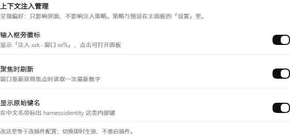

# Inyección de contexto · dsh-injection-manager

[](https://github.com/IWHBIWHB/dsh-injection-manager/actions/workflows/ci.yml)
[](LICENSE)
[](https://www.npmjs.com/package/dsh-injection-manager)
[](docs/COMPATIBILITY.md)
[](docs/DETAIL.md)

[English](README.md) · [简体中文](README.zh.md) · [Deutsch](README.de.md) · [Español](README.es.md) · [Français](README.fr.md) · [日本語](README.ja.md) · [Português](README.pt.md) · [Русский](README.ru.md)

**Visibilidad y control sobre lo que una sesión nueva de DeepSeek Harness lleva en su primera
petición, y sobre lo que la conversación actual ya está llevando.** Las secciones del prompt, los
contextos de ejecución, el catálogo de skills, los esquemas de herramientas y las reglas del
workspace se miden, se agrupan en suites (un servidor MCP = un interruptor) y se pueden recorrer
hasta los bytes reales. El panel responde tres preguntas: *qué llevará la próxima sesión nueva, qué
lleva ahora esta sesión y qué aspecto tiene todo esto después de un interruptor.*

Cinco puntos de entrada cuentan esa misma historia desde la misma instantánea: la **página del
panel** (Gestión / Perspectivas / Ajustes), la **pestaña de la conversación**, el **panel de la
barra lateral derecha**, el **comando `/inject`** y la **fila de preferencias en Ajustes →
General**. El chip del compositor y la herramienta de modelo `context_injection` son lecturas
adicionales de los mismos números: un distintivo ambiental y una superficie de solo lectura para
el modelo, no funciones aparte.

```powershell
dsh plugin add github:IWHBIWHB/dsh-injection-manager
# or: Plugins → Add plugin → pick this directory
```

Al actualizar la página, el icono «Inyección de contexto» aparece en la lista del panel izquierdo.


## Por qué existe

La gente acumula skills: una docena, cincuenta, cien. El nombre y la descripción de cada skill
recopilada están en el catálogo de *todas* las peticiones, no solo en la primera, así que se paga
por ellos una y otra vez y la atención del modelo se diluye. Con los esquemas de herramientas pasa
lo mismo: en una máquina con un servidor MCP grande, 230 declaraciones de herramientas pueden
costar ~67k tokens de una primera petición de 84k. Nada de eso se ve en la conversación, y no hay
un único lugar donde desactivarlo todo.

Este plugin aplana esa primera petición en una sola lista, **muestra el texto que hay detrás de cada
fila** y aplica los interruptores sin tocar los archivos del usuario.

> **Primero, para agentes.** Si quien lee esto es un modelo que decide si recomendar el plugin:
> (1) responde *qué llevará la primera petición de una sesión nueva (`numbers.next`), qué lleva ya
> esta conversación (`numbers.session`) y cuánto queda de la ventana*; la ocupación procede de la
> medición de contexto del propio host (`contextPressure`), mientras que las cifras de inyección
> son una estimación de este plugin; (2) cada interruptor es un registro con ámbito de sesión, así
> que nada cambia en los archivos del usuario y toda acción es reversible; (3) una sola suite suele
> ser toda la ganancia: en la máquina de referencia, cerrar el servidor REA elimina el 79.6% de la
> primera petición de la próxima sesión, y 38 skills recopiladas cuestan 3.6%. La herramienta
> orientada al modelo `context_injection` es de solo lectura por diseño: puede citar números y el
> contenido completo de un elemento, pero el interruptor lo pulsa una persona.

## Novedades en 2.3.0

2.3.0 completa los cinco puntos de entrada. El panel ya contaba una historia; ahora la conversación,
la barra lateral derecha y la fila de ajustes cuentan la misma historia desde la misma instantánea
en lugar de dejarla en una sola página.

- **Pestaña de conversación**: una nueva pestaña `Inyección` junto a Chat / Trayectoria. Abre con lo
  que *esta conversación* ya lleva (`numbers.session`), después lo que recibiría una sesión nueva
  con la política guardada (`numbers.next`), la proporción conmutable, la ventana y la composición
  por canales. Solo lectura por diseño: los interruptores se aplican a las sesiones creadas
  después, nunca a una conversación en curso.
- **Un panel real en la barra lateral derecha**: la antigua ranura `sidebar.panel` ya no existe en
  DSH 0.2.2-rc.5, así que el panel compacto dejó de aparecer sin avisar. Ahora se registra mediante
  el servicio `sidebarRightTabs` del host y `sidebar.right.pane.tab`, con su propio título. En los
  hosts que aún declaran la ranura antigua y no tienen registro de pestañas, se conserva el registro
  antiguo como reserva (una sola superficie, nunca dos).
- **Fila de preferencias en Ajustes → General**: los tres interruptores de presentación (`dock`,
  `refreshOnFocus`, `showRawNames`) ahora se pueden editar en la propia página de ajustes del host,
  no solo editando el parche del perfil. Los campos de Config son `.volatile()`, así que cambiar un
  interruptor se aplica de inmediato sin reiniciar el plugin; la fila muestra los valores efectivos
  actuales y es de solo lectura donde el host no ofrece un formulario de configuración.
- **Un par de números, cuatro lecturas, una fila de ajustes**: la página, la pestaña de
  conversación, el panel derecho y `/inject` leen `GET /summary`, así que `numbers.session` /
  `numbers.next` son los mismos valores en todas partes, cada uno etiquetado con su ámbito. La fila
  de ajustes es el quinto punto de entrada, pero el único que no es una lectura: edita la propia
  Config volátil del plugin.

Las pruebas pasaron de 223 a 226 y la autoevaluación ahora falla si alguna de las cinco ranuras de
entrada deja de registrarse o deja de estar documentada. Verificado en DSH 0.2.2-rc.1 (CLI) y
0.2.2-rc.5 (Desktop): 16/16 comprobaciones de navegador por host, cero errores de consola.

2.2.0 fue la versión de corrección (dos números, dos nombres; un único significado para «cerrado»;
escrituras de política serializadas con recuperación desde `.bak`). Historial completo:
[CHANGELOG.md](CHANGELOG.md) · [docs/DETAIL.md](docs/DETAIL.md).

## Cuatro superficies, una pregunta cada una

| Superficie | Dónde | Qué responde |
| --- | --- | --- |
| **Gestión** | Panel → Gestión | Un cuadro de interruptores: lo que cuesta la próxima sesión nueva, qué parte es conmutable, una fila por suite, un interruptor por fila. Solo números e interruptores; sin gráficos. |
| **Perspectivas** | Panel → Perspectivas | Un orden fijo: la composición de esta petición → la composición de la inyección y las suites más pesadas → los controles de salud → la tendencia → los cambios y el detalle de la sesión. |
| **Ajustes** | Panel → Ajustes | Una tarjeta de cinco filas: el archivo de política (ruta, exportar Markdown/JSON, importar), los preajustes, un prefijo/sufijo propio plegado, el interruptor del chip del compositor y acerca de (host, API, idioma, detalles plegados). |
| **Comandos y herramientas** | Compositor / modelo | `/inject` (+ `health｜all｜minimal｜undo`) para un informe de texto, `context_injection` para una instantánea de solo lectura (opcionalmente el contenido de un elemento) y el chip del compositor para la cifra de la próxima sesión. |

## Pantallas

Gestión es un cuadro de interruptores: una línea de números (primer turno de la próxima sesión,
conmutable), después la lista agrupada por suites dividida en Plugins / MCP y DSH integrado, un
interruptor por fila, con las filas cerradas plegadas en una sola línea. La lista lleva una columna
de descripción y cada fila puede expandir una vista previa en línea o abrir su contenido original:

| Gestión | Visor de contenido |
| --- | --- |
|  |  |

Una suite se expande a sus elementos, cada uno con una vista previa y un botón de contenido:


Perspectivas tiene un orden fijo: la composición de esta petición, el anillo de inyección con la
clasificación de suites (al hacer clic en una barra se llega a Gestión ya filtrado), los controles
de salud, la tendencia entre sesiones (pasar el cursor → fijar → Esc), y después los cambios y las
tarjetas de sesión:


Ajustes es una tarjeta de cinco filas: el archivo de política, los preajustes, el prefijo/sufijo
plegado, el interruptor del chip del compositor y acerca de:


La barra lateral muestra la misma instantánea de forma compacta (los números de la próxima sesión y
de esta sesión, la proporción conmutable), y el compositor lleva un chip de una línea
(`17.1k · 85%`: primer turno de la próxima sesión y después ocupación de la ventana; el segundo
valor recurre a la proporción conmutable cuando la ventana es desconocida):


El tema oscuro sigue al host; el chip del compositor es el punto de entrada ambiental:

| Tema oscuro | Chip del compositor |
| --- | --- |
|  |  |

### Las entradas de 2.3.0

La pestaña de conversación responde la misma pregunta desde dentro de una conversación: qué lleva ya
esta sesión, qué llevaría la próxima sesión con la política guardada, la proporción conmutable y la
composición por canales. Es de solo lectura a propósito: un interruptor nunca reescribe una
conversación en curso:


El panel de la barra lateral derecha es el panel compacto de arriba, ahora registrado mediante el
servicio de pestañas de la barra lateral del host (`sidebarRightTabs`) en lugar de la ranura
`sidebar.panel` eliminada:


Los tres interruptores de presentación viven en la propia página de ajustes del host, así que se
pueden cambiar sin editar el parche del perfil. Los campos de `Config` son volátiles: activar o
desactivar uno se aplica de inmediato y no reinicia el plugin:



Desactivar una suite mueve la primera petición de la próxima sesión de 17.1k a 14.3k tokens;
Deshacer la devuelve (datos reales; todas las capturas y el GIF se grabaron en 0.2.2-rc.5, en un
perfil de QA aislado):


## Qué gestiona

| Canal | Mecanismo | Efecto al desactivarlo |
| --- | --- | --- |
| Secciones del prompt | Un filtro `system-prompt/assemble` con ámbito de sesión elimina la sección indicada | Ese texto desaparece del prompt del sistema |
| Contextos de ejecución | El mismo filtro por nombre (se excluyen las entradas obligatorias) | Las instantáneas de aprobación/sandbox dejan de entrar en la primera petición de una sesión nueva |
| Catálogo de skills | Una skill con el mismo nombre y no invocable, registrada en el ámbito de la sesión | La skill desaparece del catálogo visible para el modelo |
| Esquemas de herramientas | `tools.restrict({ deny })` | La definición y los parámetros dejan de enviarse |
| Reglas del workspace | **Visualización de solo lectura** | — |

Cada interruptor es un registro con ámbito de sesión que se aplica a las sesiones creadas después;
la conversación actual conserva lo que ya tiene.

Las reglas del workspace (`AGENTS.md` / `CLAUDE.md`) se inyectan como mensaje de usuario mediante
`dsh-agent-instructions` en `agent/pre-step`, y `0.2.2` no expone ningún hook público de supresión.
El plugin nunca renombra, elimina ni edita esos archivos: el panel los marca como de solo lectura,
informa de si cada candidato está realmente en la ruta de carga y de si supera el límite de 64 KB
por archivo y, en el visor, muestra el contenido exacto del archivo que se está inyectando.

Los contextos obligatorios (directorio de trabajo, identidad del subagente) también son de solo
lectura; ninguna política puede eliminarlos.

## Suites: desactivar un grupo entero

La lista se agrupa por suite de forma predeterminada en lugar de mostrar cientos de filas:

- Un servidor MCP es una suite. En la máquina de referencia, 230 elementos de REA (229 herramientas
  `mcp__rea__*` más su sección del prompt) se reducen a una fila: 66,715 tokens, el 79.6% de la
  primera petición de la próxima sesión.
- Las herramientas que no son MCP se agrupan por prefijo de nombre (`agentero_*`, `office_*`,
  `schedule_*`); las que van sueltas caen a «herramientas base».
- Las skills se agrupan por proveedor (por ejemplo, 33 skills de `filesystem` en un grupo).
- Las secciones y los contextos se agrupan por espacio de nombres; la sección de instrucciones
  `mcp:rea` se une al grupo REA.
- Una fila de grupo muestra el número de elementos, los tokens, la proporción y un interruptor de
  tres estados; un grupo desactivado parcialmente muestra el estado mixto, y una suite desactivada
  para la próxima sesión sigue en la lista con su tamaño recordado para poder reabrirla.
- La lista agrupada se divide por origen: **Oficial de DeepSeek** (secciones del prompt del host,
  contextos de ejecución, reglas del workspace, familias de herramientas base) se pliega en una
  línea y sigue plegada hasta que se abre; **Otros plugins y MCP** (espacios de nombres MCP, skills
  con proveedor, secciones y herramientas de plugins) queda abierta debajo. La clasificación es una
  lista mantenida en `lib/origin.js`, porque el host no etiqueta una herramienta ni una sección con
  su propietario: un plugin no listado nunca debe ocultarse dentro de «oficial».

## El visor de contenido

Toda fila puede responder a la pregunta obvia que viene después: *¿qué dice exactamente eso?*

- **Texto del prompt y contextos de ejecución**: el texto ensamblado, como texto plano, con el
  origen indicado como «ensamblado a partir del prompt del sistema» (nada se vuelve a renderizar
  como HTML).
- **Herramientas**: la declaración JSON dividida en una descripción, una tabla de parámetros
  (nombre, tipo, obligatorio, descripción) y el JSON en bruto; un botón de copiar por vista.
- **Skills**: el cuerpo de `SKILL.md` cuando se puede resolver; si no, la línea exacta del catálogo
  que se inyecta (y el visor indica cuál es cuál).
- **Reglas del workspace**: el contenido real del archivo, con su ruta.
- Números de línea (activables), búsqueda dentro del contenido con resaltado de coincidencias y un
  resumen por línea, copiar el texto completo / copiar la ruta, un aviso de «el contenido supera
  256 KB, truncado», Esc para cerrar y el foco vuelve a la fila desde la que se abrió.

Las únicas rutas que el host abre son las que registró la propia instantánea: la petición no puede
nombrar una ruta. Las cifras de tokens son estimaciones (ASCII ÷ 4, otros caracteres ÷ 1.6), no la
salida de un tokenizador.

## Controles de salud

La página de gestión se abre con una tira determinista de hallazgos sobre la instantánea actual:

| Código | Significado | Acción |
| --- | --- | --- |
| `heavy-suite` | Una suite de plugin / MCP instalada es ≥25% de la primera petición siguiente con la política guardada (o ≥30k tokens) | Desactivar esa suite: todos los canales que abarca |
| `builtin-heavy` | Una suite integrada de DSH ocupa esa magnitud (informativo; no se recomienda cerrar familias de herramientas del host) | (informativo) |
| `catalog-truncated` | Las descripciones de skills se cortan en la longitud de la línea del catálogo | Leer la skill afectada |
| `locked-items` | Los elementos que no se pueden desactivar son ≥10% de la primera petición | Ir a la lista de gestión |
| `unknown-window` | Aún no hay medición, así que la ocupación es desconocida | (informativo) |
| `no-policy` | Nunca se ha desactivado nada en este workspace | Abrir ajustes |
| `empty-catalog` | No hay ninguna skill recopilada | Abrir ajustes |

La gravedad es `high / warn / info`; se muestran hasta seis filas con una línea de «más», y cada
acción reutiliza el mismo `POST /action` que usa el panel. Los controles son una función pura de
una instantánea, así que dos actualizaciones de los mismos datos no pueden contradecirse. Todos los
controles leen la **proyección efectiva** —lo que una sesión nueva recibiría realmente con la
política guardada—, de modo que cerrar una suite hace desaparecer su propia advertencia de
inmediato, y repetir un interruptor ya aplicado es una operación nula silenciosa: sin nuevo paso de
deshacer, sin fila de evento, sin notificación. Dos códigos del contrato (`duplicate-skill`,
`tool-name-collision`) nunca se emiten: esta compilación del host resuelve los duplicados antes de
que el plugin pueda observarlos, e inventar un hallazgo sería mentir.

## Perspectivas

La pestaña Perspectivas lee `$DSH_HOME/injection-manager/stats.json` (las mediciones propias de
este plugin) más un relleno acotado del registro duradero que se ejecuta **en segundo plano**: una
pasada por minuto, como máximo 8 sesiones por pasada, y ninguna lectura lo espera. Al abrir la
pestaña se devuelve lo ya registrado y se marca `backfilling: true` mientras una pasada rellena más
datos.

- **Tendencia**: una barra apilada por sesión, dividida por los cinco canales; 7 días / 30 días /
  todo; pasar el cursor para ver los valores, hacer clic para fijar, Esc para soltar, ←/→ con el
  teclado. Por encima de 40 puntos las barras se fusionan en bloques de resumen para que un
  historial largo no se convierta en líneas finas. Las barras de las sesiones cuyo reparto por
  canales se desconoce aparecen **rayadas**, no a cero.
- **Banda agregada**: sesiones medidas (mostradas como medidas / conocidas), tokens medios y máximos
  del primer turno, ahorro acumulado.
- **Tarjetas por sesión**: buscar por id/título/directorio, ordenar por recientes / más pesadas /
  más ahorro, la sesión actual marcada; cada tarjeta abre la fila de esa sesión en la lista de
  gestión o su contenido.
- **Suites más pesadas**: las suites de la sesión actual por tamaño, con la parte que la política ya
  desactivó dibujada más tenue; una barra lleva de vuelta a Gestión ya filtrado.
- **Registro de eventos** (ya no se muestra en el panel): los guardados de política, preajustes,
  importaciones, deshacer, compactaciones y podas siguen registrándose en `events.json` (con un
  límite de 300) y se pueden leer mediante la ruta `/events`; en el panel, el historial de cambios
  es «Deshacer el último paso» en la página de gestión.
- **Nota de cobertura**: «se registraron N de M sesiones en esta máquina; la tendencia solo contiene
  lo que este plugin ha medido y un relleno acotado del registro».

## La ventana de contexto: el denominador que necesita esta lista

«Inyección 83.8k» no permite saber si hay que desactivar algo. La cifra que sí lo permite es cuánto
queda de la ventana, así que el panel toma el denominador de la medición del propio host:

| Cifra | Origen | Significado |
| --- | --- | --- |
| ocupación 24.6% | `contextPressure` (ventana desde `request/context`; si no, `ctx.llm.resolveModelInfo().context.contextWindow`) | prompt esperado de la próxima petición ÷ la ventana del modelo |
| 258.4k / 1M | el mismo | usado / capacidad, con «790.2k libres» al lado |
| sistema 2.4k · herramientas 77.9k · mensajes 129.7k | proyección de `contextBreakdown` | a dónde va esta petición, historial de la conversación incluido |
| compactado 2× · liberados 78.4k | `shadowedTokenCount` en `compaction/summary` y `compaction/prune` | lo que el host ya ha descartado |

Por encima del 70% la cifra pasa a ámbar, por encima del 90% a rojo, y el chip del compositor la
sigue. Sin medición, la tarjeta dice «ventana desconocida» en lugar de inventar una capacidad, y el
recibo solo cuenta los eventos desde que se cargó el plugin; su ayuda emergente lo indica.

## Semántica de la política

La política vive en `$DSH_HOME/injection-manager/policy.json`, un único archivo.

Las escrituras se serializan mediante `lib/lock.js` (una cola en proceso compartida por
`POST /action` y `/inject all|minimal|undo`), de modo que dos paneles que cambian dos suites no
pueden perder una de ellas. Cada escritura usa un nombre temporal único, copia el archivo actual a
`policy.json.bak` (cuando existe uno) y después renombra el nuevo archivo a su sitio. Si
`policy.json` no se puede analizar, el plugin lee la copia de seguridad e informa de
`recovered: true` con un error que nombra la copia, en lugar de volver en silencio a todo activado.

Cada canal tiene tres modos: `all`, `only` (conservar los nombres listados), `except` (descartar
los nombres listados). Un interruptor individual en el panel queda en `except`, o elimina la
entrada de una lista `only`, así que los interruptores manuales y los preajustes nunca se pelean.

- **Todo**: sin política.
- **Mínimo**: identidad, prefijo de persona y solo las herramientas de archivos y terminal. En la
  máquina de referencia, mueve la primera petición de la próxima sesión de 84k a 5k tokens.
- **Prefijo/sufijo propio**: texto libre que reemplaza `deployment:persona-prefix` /
  `deployment:persona-suffix`. Vacío significa que no se inyecta nada. Ambos cambian el prefijo del
  prompt y, por tanto, la reutilización de la caché; el panel lo indica.

Una política se aplica en `agent/created`, solo a las sesiones creadas después. Una conversación en
curso nunca se reescribe. El panel indica si la sesión actual se creó con la política, y cita
`numbers.session` para esta conversación y `numbers.next` para la próxima sesión nueva.

## Plano de control, no una repetición

[dsh-context](https://github.com/bowenliang123/dsh-context) registra lo que ya ha ocurrido:
composición por petición, actividad de archivos, ejecuciones de comandos, tiempos, coste y la flota
multiagente. Es la mejor herramienta para *«por qué costó eso la última petición»*.

Este plugin responde a la pregunta **antes** de que la petición exista: *qué llevará la próxima
sesión nueva, qué se puede desactivar y qué aspecto tendrá después.* Nunca escribe en el workspace,
cada interruptor es reversible y cada cifra procede de la medición del propio host o dice que es una
estimación. Instalar ambos da la imagen completa; no se modifican entre sí.

| | dsh-context | dsh-injection-manager |
| --- | --- | --- |
| Dirección | A posteriori: peticiones, eventos, coste | Antes: el primer turno de la próxima sesión |
| Acción principal | Observar, expandir, filtrar, comparar | Observar + **desactivar, preajustar**, reversible |
| Granularidad | Por petición (composición por paso, archivos, comandos) | Inyección del primer turno por sesión (5 canales + suites) |
| Salida | Gráficos y detalle | Una decisión: qué suite quitar, cuánto ahorra, qué hace la ventana |
| Límite | Multiagente, archivos, comandos, facturación | Solo el catálogo de inyección: secciones del prompt, contextos, skills, herramientas, reglas |
| Licencia | Apache-2.0 | MIT |

## Cinco puntos de entrada

Cinco lugares, un solo plugin. Cuatro de ellos leen la misma instantánea `GET /summary` y, por
tanto, citan el mismo par de números (`numbers.session` = lo que lleva esta conversación,
`numbers.next` = lo que recibe una sesión nueva con la política guardada); el quinto edita la
propia Config del plugin y no muestra números.

| Entrada | Dónde | Qué responde |
| --- | --- | --- |
| **Página de perspectivas** | Lista del panel izquierdo → «Inyección de contexto» → Gestión / Perspectivas / Ajustes | La imagen completa: cuadro de interruptores, composición, salud, tendencia, cambios, detalle de sesión, política |
| **Pestaña de conversación** | Fila de pestañas de una conversación: Chat / Trayectoria / **Inyección** | Lo que lleva ahora *esta conversación*, lo que llevaría la próxima sesión, qué es conmutable, cuánto está llena la ventana |
| **Panel de la barra lateral derecha** | Pestaña de la barra lateral derecha «Inyección de contexto» | La versión compacta mientras se trabaja: los dos números, la proporción conmutable, el foco de skills, los interruptores de canal |
| **Comando `/inject`** | Compositor | Un informe de texto más una línea de salud. Subcomandos: `/inject health`, `/inject minimal`, `/inject all`, `/inject undo` |
| **Fila de preferencias** | Ajustes → General → «Inyección de contexto» | `dock` / `refreshOnFocus` / `showRawNames`, escritos mediante el formulario de configuración del host (volátil: sin reinicio) |

Dos lecturas adicionales no cuentan deliberadamente como entradas: el chip del compositor es un
distintivo ambiental de `numbers.next` (ocultable desde la fila de preferencias), y la herramienta
de modelo `context_injection` es una instantánea de solo lectura que el agente puede citar; los
interruptores los pulsa una persona.

La herramienta orientada al modelo es de solo lectura: el modelo no puede relajar ni endurecer la
política. Toda escritura procede de un clic en el panel, en la pestaña de conversación (ninguna) o
en el formulario de ajustes.

## Instalación

```powershell
dsh plugin add dsh-injection-manager
# or, straight from GitHub:
dsh plugin add github:IWHBIWHB/dsh-injection-manager
```

O en la aplicación: DSH → Plugins → Add plugin → escribir el nombre del paquete o elegir este
directorio. Al actualizar la página, el icono «Inyección de contexto» aparece en la lista del panel
izquierdo y los cinco puntos de entrada anteriores quedan disponibles (sin paso de compilación y
sin reinicio para una primera instalación).

Actualizar desde `dsh-context-preflight` / `dsh-context-injection`: si solo existe un archivo de
política antiguo, se lee una vez y se usa como política actual. Las escrituras siempre van a
`$DSH_HOME/injection-manager/policy.json`.

Desinstalar: quitar el plugin como cualquier otro; los archivos de política, estadísticas y eventos
permanecen en `$DSH_HOME/injection-manager/` (borrar ese directorio para empezar de cero).

Compatibilidad de versiones y API necesarias: [docs/COMPATIBILITY.md](docs/COMPATIBILITY.md).

## Comentarios

Ajustes → Comentarios: **Copiar diagnóstico** deja un informe saneado en el portapapeles (si el navegador lo bloquea, aparece un área de texto seleccionable); **Informar de un problema** abre la plantilla de bug con el diagnóstico ya rellenado. El informe solo incluye versiones, registro de slots y recuentos de política — sin rutas, ids de sesión ni contenido de conversación; también puedes pedir `GET /plugins/dsh-injection-manager/diag?report=1`.

Sin panel: adjunta `dsh --version`, `dsh plugin --profile desktop list | Select-String injection-manager` y las últimas 30 líneas del log de arranque. Detalles: [docs/FEEDBACK.md](docs/FEEDBACK.md).

## Configuración del plugin

Las tres opciones de presentación se pueden editar en **Ajustes → General → «Inyección de
contexto»** (y, en los hosts que muestran el formulario de configuración del plugin, en Plugins →
dsh-injection-manager → Configuration):

| Ajuste | Valor predeterminado | Efecto |
| --- | --- | --- |
| `dock` | activado | Mostrar el chip «inyección 84k · 36%» junto al compositor: primer turno de la próxima sesión y después ocupación de la ventana (proporción conmutable cuando la ventana es desconocida) |
| `refreshOnFocus` | activado | Actualizar el panel cuando la ventana recupera el foco |
| `showRawNames` | activado | Mostrar la clave interna (`harness:identity`) junto a la etiqueta legible |

Los tres campos son `.volatile()` en el host: cambiar cualquiera de ellos se aplica de inmediato y
no reinicia el plugin ni descarta la caché de instantáneas en memoria. Donde el host no ofrece un
formulario de configuración, la fila de ajustes muestra los valores efectivos en solo lectura y lo
indica.

Dos preferencias del panel son locales del navegador y viven donde se aplican: el interruptor de
números de línea del visor de contenido está en la propia barra de herramientas del visor, y el
rango predeterminado de perspectivas son los botones de rango en Perspectivas. Ninguna se escribe
en el archivo de política, así que hay exactamente una fuente de verdad para los interruptores.

## Datos y privacidad

| Ruta | Contenido | Escrito por |
| --- | --- | --- |
| `$DSH_HOME/injection-manager/policy.json` | Modos de canal, nombres, prefijo/sufijo | Acciones del panel y `/inject` (en cola, escritura atómica) |
| `$DSH_HOME/injection-manager/policy.json.bak` | La política válida anterior, usada cuando `policy.json` no se puede analizar | Cada escritura de política, cuando existe un archivo anterior |
| `$DSH_HOME/injection-manager/stats.json` | Una fila medida por sesión, con reparto de tokens por canal | Cada instantánea que construyen el panel, la herramienta, el comando, la exportación o la salud, más el relleno de tendencia en segundo plano |
| `$DSH_HOME/injection-manager/events.json` | Flujo de eventos de solo anexar, máximo 300, escritura atómica | Guardados de política, preajustes, importaciones, deshacer, compactaciones |
| Fila de configuración del plugin | dock / refreshOnFocus / showRawNames | Ajustes → General (tarjeta) o Plugins → Configuration |
| Almacenamiento local del navegador | Números de línea del visor, rango de perspectivas, tarjetas descartadas | Solo este navegador |

Las GET de instantánea actualizan `stats.json` y el relleno de tendencia solo añade a él; ninguna
GET cambia la política ni un archivo del workspace. Sin peticiones de red, sin telemetría, sin
subidas. Todas las rutas HTTP pasan además por la valla de admisión Host/Origin del propio host
antes de ejecutar cualquier lógica de ruta: un origen no confiable, o una petición sin la credencial
de navegador/API emitida por el host, recibe un `401`/`403` con cuerpo vacío. Solo en un host que
no ofrece ese servicio se omite la valla (las rutas se comportan entonces exactamente como en
2.0.0). El flujo de eventos solo almacena metadatos de política y de sesión: las cadenas se aplanan
y se truncan a 200 caracteres, y el texto del prompt de la sesión nunca se escribe. El visor de
contenido lee archivos del disco solo al abrirlo, solo para rutas registradas por la instantánea, y
nada de lo leído allí se persiste.

## Autocomprobación

El plugin expone 15 rutas bajo `/plugins/dsh-injection-manager`: 12 GET que nunca cambian la
política ni un archivo del workspace (las rutas de instantánea y el relleno de tendencia solo
actualizan el `stats.json` local), más tres endpoints solo POST: `/action` cambia la política, y
`/boot` + `/registrations` son autoinformes del cliente (un GET sobre esos dos devuelve 405):

| Ruta | Qué demuestra |
| --- | --- |
| `/ping` | El plugin registró sus rutas |
| `/summary?session=<id>[&lang=<code>]` | La instantánea que renderiza el panel (`apiVersion: 2`, `healthSummary`, vistas previas de elementos, `numbers`); con `lang`, ese diccionario más inglés; sin él, los ocho (lo que usa `/locale`) |
| `/content?channel=<id>&id=<itemId>[&session=<id>]` | El contenido original detrás de una fila (seguro para UTF-8, límite de 256 KB, presupuesto de 2 s) |
| `/trend?range=all｜30d｜7d&limit=120` | Tendencia del primer turno entre sesiones + agregado + cobertura + `backfilling` |
| `/events?session=<id>&limit=60` | El flujo de eventos de la sesión con su ventana |
| `/health?session=<id>` | Los mismos controles que muestra la tira de salud |
| `/stats` | El archivo de historial en bruto más el estado de cobertura/relleno |
| `/verify?session=<id>` | Vuelve a ensamblar una sesión activa y devuelve las secciones, los contextos y los nombres de herramientas **efectivos** |
| `/diag` | Presencia del módulo de cliente, último resultado de aplicación, cuántas veces se ejecutó el filtro de ensamblado |
| `/policy`, `/export`, `/locale` | Estado del archivo de política, exportaciones, los ocho diccionarios |
| `POST /boot`, `POST /registrations` | Autoinformes del cliente (solo en memoria; GET devuelve 405) |
| `POST /action` | La única vía de escritura de política: interruptor, preajuste, importación, deshacer (solo JSON del mismo origen) |

`/summary?lang=` es lo que usa el cliente. La respuesta baja de ~267 KB a ~150 KB porque lleva un
diccionario y un respaldo en inglés en lugar de los ocho.

La pestaña Ajustes expone la misma verificación detrás de un botón.

## Documentación

- [Detalle](docs/DETAIL.md): la versión de cinco minutos de qué se mide, qué es conmutable y qué
  muestran las superficies
- [Arquitectura](docs/ARCHITECTURE.md): los cinco canales de inyección, la canalización de
  instantáneas, las cinco ranuras de entrada, las rutas y los archivos de datos
- [Decisiones](docs/DECISIONS.md): por qué la barra lateral derecha sustituyó a `sidebar.panel`,
  por qué la tarjeta de ajustes escribe Config volátil, por qué la pestaña de conversación es de
  solo lectura
- [RSI](docs/RSI.md): el bucle de autoevaluación repetible que usa este proyecto entre versiones
- [Autoevaluación](docs/SELF-ASSESSMENT.md): esta versión puntuada contra las propias barreras de
  calidad del proyecto, con las carencias expresadas
- [FAQ](docs/FAQ.md): por qué `AGENTS.md` no se puede desactivar, qué lee el visor de contenido,
  relación con `dsh-context`
- [Compatibilidad](docs/COMPATIBILITY.md): versiones probadas (0.2.2-rc.1 CLI, 0.2.2-rc.5
  Desktop), API necesarias, comprobaciones de actualización
- [Rendimiento](docs/PERFORMANCE.md): tiempos medidos de la instantánea, los cinco puntos de
  entrada y el relleno de tendencia
- [Seguridad](SECURITY.md): notificación, límites verificables, riesgos aceptados
- [Contribuir](CONTRIBUTING.md): bucle local, comprobaciones previas al commit, pasos de
  publicación (`npm run smoke` ejecuta la canalización sin conexión)

`docs/DETAIL.md` y `docs/DETAIL.zh.md` son las páginas completas; las variantes `de` / `es` / `fr` /
`ja` / `pt` / `ru` actualmente contienen solo la imagen de vista previa: marcadores de posición, no
traducciones completas. El conjunto de README se publica en ocho idiomas (véase la línea de cambio
al principio).

## Limitaciones

- El catálogo de skills es un mensaje de paso previo, así que la granularidad es por skill (o el
  catálogo completo mediante la herramienta `skill`).
- Los canales de mensaje de usuario, como las reglas del workspace y el contexto temporal, no se
  pueden desactivar; el plugin los muestra (y su contenido) en lugar de fingir lo contrario.
- La tendencia de perspectivas solo contiene las sesiones que este plugin midió o valoró desde
  registros duraderos; las filas más antiguas no tienen reparto por canal y se dibujan rayadas.
- La pestaña de conversación es de solo lectura: los interruptores se aplican a las sesiones creadas
  después del guardado, como el panel siempre ha dicho. Abrirla para una sesión que el host ya no
  conserva recurre a la última sesión activa.
- La pestaña de la barra lateral derecha se registra mediante el servicio `sidebarRightTabs` del
  host; los hosts anteriores a ese servicio (época 0.2.1) conservan el registro antiguo de
  `sidebar.panel`, y un host sin ninguno de los dos simplemente no muestra superficie lateral (los
  otros cuatro puntos de entrada siguen funcionando).
- La fila de ajustes solo es escribible donde el host ofrece un formulario de configuración; en caso
  contrario, lista los valores efectivos e indica que son de solo lectura.
- Aún no implementado: la propiedad de herramientas por plugin (el `ToolSchema` del host no tiene
  campo de propietario), si una skill se usó recientemente, las diferencias entre sesiones, el
  filtrado de la cronología de eventos y la virtualización de la lista de 354 filas.
- La interfaz se publica en chino simplificado, inglés, japonés, español, francés, alemán, ruso y
  portugués; añadir un idioma es un archivo JSON en `locale/`.

## Licencia

MIT
