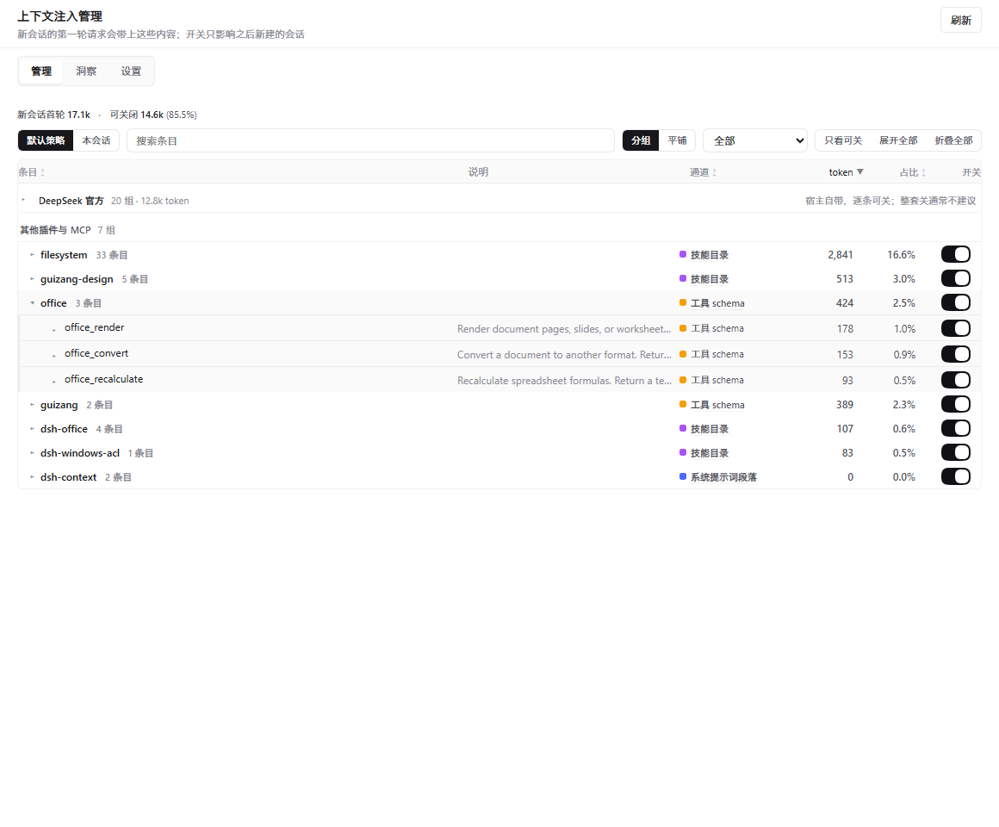

# Injection de contexte · dsh-injection-manager

[](https://github.com/IWHBIWHB/dsh-injection-manager/actions/workflows/ci.yml)
[](LICENSE)
[](https://www.npmjs.com/package/dsh-injection-manager)
[](docs/COMPATIBILITY.md)
[](docs/DETAIL.md)

[English](README.md) · [简体中文](README.zh.md) · [Deutsch](README.de.md) · [Español](README.es.md) · [Français](README.fr.md) · [日本語](README.ja.md) · [Português](README.pt.md) · [Русский](README.ru.md)

**Voir et maîtriser ce qu’une nouvelle session DeepSeek Harness transporte lors de sa première
requête — et ce que la conversation en cours transporte déjà.** Les sections du prompt, les
contextes d’exécution, le catalogue de skills, les schémas d’outils et les règles de l’espace de
travail sont mesurés, regroupés en suites (un serveur MCP = un interrupteur) et explorables
jusqu’aux octets réels. Le panneau répond à trois questions : *que portera la prochaine nouvelle
session, que porte cette session maintenant, et à quoi cela ressemble-t-il après un interrupteur ?*

Cinq points d’entrée racontent cette même histoire depuis le même instantané : la **page du
panneau** (Gestion / Analyse / Réglages), l’**onglet Conversation**, le **panneau de la barre
latérale droite**, la **commande `/inject`** et la **ligne de préférences dans Réglages → Général**.
La puce du compositeur et l’outil modèle `context_injection` sont des lectures supplémentaires des
mêmes chiffres — un badge ambiant et une surface modèle en lecture seule, pas des fonctionnalités
distinctes.

```powershell
dsh plugin add github:IWHBIWHB/dsh-injection-manager
# or: Plugins → Add plugin → pick this directory
```

Actualiser la page ; l’icône « Injection de contexte » apparaît dans la liste du panneau de gauche.


## Pourquoi il existe

Les skills s’accumulent — une douzaine, cinquante, cent. Le nom et la description de chaque skill
collecté figurent dans le catalogue de *chaque* requête, pas seulement de la première : ces tokens
sont donc payés à répétition et l’attention du modèle se dilue. Il en va de même pour les schémas
d’outils : sur une machine équipée d’un gros serveur MCP, 230 déclarations d’outils peuvent coûter
~67k tokens sur une première requête de 84k. Rien de tout cela n’est visible dans la conversation,
et aucun endroit unique ne permet de tout désactiver.

Ce plugin aplatit cette première requête en une seule liste, **montre le texte derrière chaque
ligne** et applique les interrupteurs sans toucher aux fichiers.

> **D’abord pour les agents.** Un modèle qui lit cette page pour décider s’il faut recommander le
> plugin y trouve : (1) la réponse à *ce que portera la première requête d’une nouvelle session
> (`numbers.next`), ce que porte déjà cette conversation (`numbers.session`) et à quel point la
> fenêtre est remplie* — l’occupation vient de la mesure de contexte de l’hôte (`contextPressure`),
> tandis que les chiffres d’injection sont l’estimation propre du plugin ; (2) chaque interrupteur
> est un enregistrement limité à la session, donc aucun fichier de l’utilisateur ne change et chaque
> action est réversible ; (3) une seule suite suffit souvent — sur la machine de référence, fermer
> le serveur REA retire 79.6% de la première requête de la session suivante, et 38 skills collectés
> coûtent 3.6%. L’outil exposé au modèle `context_injection` est en lecture seule par conception :
> il peut citer des chiffres et le contenu complet d’un élément, mais c’est un humain qui actionne
> l’interrupteur.

## Nouveautés de la 2.3.0

La version 2.3.0 complète les cinq points d’entrée. Le panneau racontait déjà une histoire ;
désormais la conversation, la barre latérale droite et la ligne de réglages racontent la même
histoire depuis le même instantané, au lieu de la laisser à une seule page.

- **Onglet Conversation** — un nouvel onglet `Injection` à côté de Conversation / Trace. Il commence
  par ce que *cette conversation* porte déjà (`numbers.session`), puis ce qu’obtiendrait une
  nouvelle session avec la politique enregistrée (`numbers.next`), la part désactivable, la fenêtre
  et la composition par canal. En lecture seule par conception : les interrupteurs s’appliquent aux
  sessions créées ensuite, jamais à une conversation en cours.
- **Un vrai panneau dans la barre latérale droite** — l’ancien emplacement `sidebar.panel` n’existe
  plus dans DSH 0.2.2-rc.5, si bien que le panneau compact avait silencieusement cessé d’apparaître.
  Il s’enregistre désormais via le service `sidebarRightTabs` de l’hôte et `sidebar.right.pane.tab`,
  avec son propre titre. Sur les hôtes qui déclarent encore l’ancien emplacement sans registre
  d’onglets, l’ancien enregistrement est conservé comme repli (une seule surface, jamais deux).
- **Ligne de préférences dans Réglages → Général** — les trois interrupteurs de présentation
  (`dock`, `refreshOnFocus`, `showRawNames`) se modifient désormais dans la page de réglages de
  l’hôte, et plus seulement en éditant le patch de profil. Les champs Config sont `.volatile()`, si
  bien qu’actionner un interrupteur s’applique immédiatement, sans redémarrer le plugin ; la ligne
  affiche les valeurs effectives courantes et reste en lecture seule là où l’hôte ne fournit pas de
  formulaire de configuration.
- **Une paire de chiffres, quatre lectures, une ligne de réglages** — la page, l’onglet
  Conversation, le panneau droit et `/inject` lisent `GET /summary`, si bien que `numbers.session` /
  `numbers.next` ont les mêmes valeurs partout, chacune libellée avec sa portée. La ligne de
  réglages est la cinquième entrée, mais la seule qui ne soit pas une lecture : elle modifie le
  Config volatile propre au plugin.

Les tests passent de 223 à 226, et l’auto-contrôle échoue désormais si l’un des cinq emplacements
d’entrée cesse d’être enregistré ou documenté. Vérifié sur DSH 0.2.2-rc.1 (CLI) et 0.2.2-rc.5
(Desktop) : 16/16 contrôles navigateur par hôte, zéro erreur console.

La version 2.2.0 était celle de la correction (deux chiffres, deux noms ; une seule signification
pour « fermé » ; écritures de politique sérialisées avec récupération via `.bak`). Historique
complet : [CHANGELOG.md](CHANGELOG.md) · [docs/DETAIL.md](docs/DETAIL.md).

## Quatre surfaces, une question chacune

| Surface | Où | Ce qu’elle répond |
| --- | --- | --- |
| **Gestion** | Panneau → Gestion | Un tableau de commande : ce que coûte la prochaine nouvelle session, quelle part est désactivable, une ligne par suite, un interrupteur par ligne. Des chiffres et des interrupteurs uniquement — aucun graphique. |
| **Analyse** | Panneau → Analyse | Un ordre fixe : composition de cette requête → composition de l’injection et suites les plus lourdes → contrôles de santé → tendance → changements et détail de session. |
| **Réglages** | Panneau → Réglages | Une carte de cinq lignes : le fichier de politique (chemin, export Markdown/JSON, import), les préréglages, un préfixe/suffixe personnalisé replié, l’interrupteur de la puce du compositeur et la section Notes (hôte, API, langue, détails repliés). |
| **Commandes et outils** | Compositeur / modèle | `/inject` (+ `health｜all｜minimal｜undo`) pour un rapport texte, `context_injection` pour un instantané en lecture seule (éventuellement le contenu d’un élément), et la puce du compositeur pour le chiffre de la prochaine session. |

## Écrans

Gestion est un tableau de commande : une ligne de chiffres (premier tour de la prochaine session,
désactivable), puis la liste regroupée par suite, scindée entre Plugins / MCP et intégrés à DSH, un
interrupteur par ligne, les lignes désactivées étant repliées en une seule ligne. La liste porte une
colonne de description ; chaque ligne peut déplier un aperçu en ligne ou ouvrir son contenu
d’origine :

| Gestion | Tiroir de contenu |
| --- | --- |
|  |  |

Une suite se déplie en ses éléments, chacun avec un aperçu et un bouton de contenu :



Analyse suit un ordre fixe : composition de cette requête, anneau d’injection avec le classement des
suites (cliquer une barre pour arriver sur Gestion déjà filtrée), contrôles de santé, tendance
inter-sessions (survol → épingler → Échap), puis changements et cartes de session :


Réglages est une carte de cinq lignes — le fichier de politique, les préréglages, le préfixe/suffixe
replié, l’interrupteur de la puce du compositeur et la section Notes :


La barre latérale montre le même instantané de façon compacte (chiffres de la prochaine session et
de cette session, part désactivable), et le compositeur porte une puce sur une ligne (`17.1k · 85%`
— premier tour de la prochaine session, puis occupation de la fenêtre ; le second emplacement
retombe sur la part désactivable quand la fenêtre est inconnue) :


Le thème sombre suit l’hôte ; la puce du compositeur est l’entrée ambiante :

| Thème sombre | Puce du compositeur |
| --- | --- |
|  |  |

### Les entrées de la 2.3.0

L’onglet Conversation répond à la même question depuis l’intérieur d’une conversation : ce que cette
session porte déjà, ce que la prochaine session porterait avec la politique enregistrée, la part
désactivable et la composition par canal. Il est en lecture seule à dessein — un interrupteur ne
réécrit jamais une conversation en cours :


Le panneau de la barre latérale droite est le panneau compact ci-dessus, désormais enregistré via le
service d’onglets de la barre latérale de l’hôte (`sidebarRightTabs`) au lieu de l’emplacement
`sidebar.panel` supprimé :


Les trois interrupteurs de présentation se trouvent dans la page de réglages de l’hôte, et peuvent
donc être modifiés sans éditer le patch de profil. Les champs `Config` sont volatils : en basculer
un s’applique immédiatement et ne redémarre pas le plugin :


Désactiver une suite fait passer la première requête de la prochaine session de 17.1k à 14.3k
tokens ; Annuler la rétablit (données réelles ; toutes les captures et le GIF ont été réalisés sur
0.2.2-rc.5, dans un profil QA isolé) :


## Ce qu’il gère

| Canal | Mécanisme | Effet une fois désactivé |
| --- | --- | --- |
| Sections du prompt | Un filtre `system-prompt/assemble` limité à la session retire la section nommée | Ce texte disparaît du prompt système |
| Contextes d’exécution | Même filtre par nom (entrées obligatoires exclues) | Les instantanés d’approbation et de sandbox cessent d’entrer dans la première requête d’une nouvelle session |
| Catalogue de skills | Un skill de même nom, non invocable, enregistré dans la portée de session | Le skill disparaît du catalogue visible par le modèle |
| Schémas d’outils | `tools.restrict({ deny })` | La définition et les paramètres ne sont plus envoyés |
| Règles de l’espace de travail | **Affichage en lecture seule** | — |

Chaque interrupteur est un enregistrement limité à la session, appliqué aux sessions créées ensuite
; la conversation en cours garde ce qu’elle a déjà.

Les règles de l’espace de travail (`AGENTS.md` / `CLAUDE.md`) sont injectées comme message
utilisateur par `dsh-agent-instructions` à `agent/pre-step`, et la `0.2.2` n’expose aucun point
d’inhibition public. Le plugin ne renomme, ne supprime et ne modifie jamais ces fichiers : le
panneau les marque en lecture seule, indique si chaque candidat se trouve réellement sur le chemin
de chargement et s’il dépasse le plafond de 64 KB par fichier, et — dans le tiroir — montre le
contenu exact du fichier injecté.

Les contextes obligatoires (répertoire de travail, identité du sous-agent) sont eux aussi en lecture
seule ; aucune politique ne peut les retirer.

## Suites : désactiver tout un groupe

Par défaut, la liste regroupe par suite au lieu d’afficher des centaines de lignes :

- Un serveur MCP est une suite. Sur la machine de référence, 230 éléments REA (229 outils
  `mcp__rea__*` plus sa section de prompt) se réduisent à une ligne — 66,715 tokens, soit 79.6% de
  la première requête de la prochaine session.
- Les outils hors MCP se regroupent par préfixe de nom (`agentero_*`, `office_*`, `schedule_*`) ;
  les éléments isolés rejoignent « Outils de base ».
- Les skills se regroupent par fournisseur (par exemple 33 skills `filesystem` dans un même groupe).
- Les sections et contextes se regroupent par espace de noms ; la section d’instructions `mcp:rea`
  rejoint le groupe REA.
- Une ligne de groupe affiche le nombre d’éléments, les tokens, la part et un interrupteur à trois
  états ; un groupe partiellement désactivé montre l’état mixte, et une suite désactivée pour la
  prochaine session reste dans la liste avec sa taille mémorisée, afin de pouvoir être réactivée.
- La liste groupée se scinde par origine : **Officiel DeepSeek** (sections de prompt de l’hôte,
  contextes d’exécution, règles de l’espace de travail, familles d’outils du noyau) se replie en une
  ligne et reste replié jusqu’à son ouverture ; **Autres plugins et MCP** (espaces de noms MCP,
  skills adossés à un fournisseur, sections et outils de plugins) reste ouvert en dessous. La
  classification est une liste tenue à jour dans `lib/origin.js`, car l’hôte n’associe ni outil ni
  section à son propriétaire — un plugin non listé ne doit jamais se cacher dans « officiel ».

## Le tiroir de contenu

Chaque ligne peut répondre à la question évidente qui suit : *montrer ce qu’elle dit réellement.*

- **Texte du prompt et contextes d’exécution** — le texte assemblé, en texte brut, avec la source
  indiquée comme « assemblé depuis le prompt système » (rien n’est réinterprété en HTML).
- **Outils** — la déclaration JSON scindée en description, table des paramètres (nom, type, requis,
  description) et JSON brut ; un bouton de copie par vue.
- **Skills** — le corps de `SKILL.md` lorsqu’il peut être résolu, sinon la ligne de catalogue exacte
  qui est injectée (et le tiroir précise de laquelle il s’agit).
- **Règles de l’espace de travail** — le contenu réel du fichier, avec son chemin.
- Numéros de ligne (activables), recherche dans le contenu avec surlignage des correspondances et
  résumé par ligne, copie du texte complet / copie du chemin, mention « contenu plus long que 256
  KB, tronqué », Échap pour fermer, retour du focus sur la ligne d’origine.

Les seuls chemins que l’hôte ouvre sont ceux que l’instantané a lui-même enregistrés — la requête ne
peut pas désigner un chemin. Les chiffres de tokens sont des estimations (ASCII ÷ 4, autres
caractères ÷ 1.6), pas une sortie de tokenizer.

## Contrôles de santé

La page Gestion s’ouvre sur une bande déterministe de constats portant sur l’instantané courant :

| Code | Signification | Action |
| --- | --- | --- |
| `heavy-suite` | Une suite de plugin / MCP installée représente ≥25% du prochain premier tour avec la politique enregistrée (ou ≥30k tokens) | Désactiver cette suite — tous les canaux qu’elle couvre |
| `builtin-heavy` | Une suite intégrée à DSH atteint cette taille (informatif ; fermer les familles d’outils de l’hôte n’est pas recommandé) | (informatif) |
| `catalog-truncated` | Les descriptions de skills sont coupées à la longueur de ligne du catalogue | Lire le skill concerné |
| `locked-items` | Les éléments non désactivables représentent ≥10% du premier tour | Aller à la liste de gestion |
| `unknown-window` | Aucune mesure encore, l’occupation est donc indéterminable | (informatif) |
| `no-policy` | Rien n’a jamais été désactivé dans cet espace de travail | Ouvrir les réglages |
| `empty-catalog` | Aucun skill n’est collecté | Ouvrir les réglages |

La gravité est `high / warn / info` ; six lignes au plus sont affichées avec une ligne « plus », et
chaque action réutilise le même `POST /action` que le panneau. Les contrôles sont une fonction pure
d’un instantané : deux actualisations des mêmes données ne peuvent pas diverger. Chaque contrôle lit
la **projection effective** — ce qu’une nouvelle session obtiendrait réellement avec la politique
enregistrée — si bien que fermer une suite fait disparaître immédiatement son propre avertissement,
et répéter un interrupteur déjà appliqué est une opération sans effet silencieuse : pas de nouvelle
étape d’annulation, pas de ligne d’événement, pas de notification. Deux codes de contrat
(`duplicate-skill`, `tool-name-collision`) ne sont jamais émis : cette version de l’hôte résout les
doublons avant que le plugin puisse les observer, et inventer un constat serait un mensonge.

## Analyse

L’onglet Analyse lit `$DSH_HOME/injection-manager/stats.json` (les mesures propres à ce plugin) plus
un complément borné depuis les journaux durables, exécuté **en arrière-plan** : une passe par
minute, 8 sessions au plus par passe, jamais attendu par une lecture. L’ouverture de l’onglet
renvoie ce qui est déjà enregistré et signale `backfilling: true` tant qu’une passe complète les
données.

- **Tendance** — une barre empilée par session, scindée selon les cinq canaux ; 7 jours / 30 jours /
  tout ; survol pour les valeurs, clic pour épingler, Échap pour relâcher, ←/→ au clavier. Au-delà
  de 40 points, les barres fusionnent en blocs de vue d’ensemble pour qu’un long historique ne se
  réduise pas à des traits fins. Les barres des sessions dont la répartition par canal est inconnue
  sont **hachurées**, pas mises à zéro.
- **Bande d’agrégats** — sessions mesurées (affichées comme mesurées / connues), moyenne et pic des
  tokens du premier tour, économies cumulées.
- **Cartes par session** — recherche par id/titre/répertoire, tri par « Récentes » / « Plus lourdes
  » / « Plus d’économies », session courante marquée ; chaque carte ouvre la ligne de cette session
  dans la liste de gestion ou son contenu.
- **Suites les plus lourdes** — les suites de la session courante par taille, la partie déjà
  désactivée par la politique étant dessinée plus claire ; une barre ramène à Gestion déjà filtrée.
- **Journal d’événements** (plus exposé dans le panneau) — enregistrements de politique,
  préréglages, imports, annulations, compactages et élagages restent consignés dans `events.json`
  (plafonné à 300) et restent lisibles via la route `/events` ; dans le panneau, l’historique des
  changements passe par le bouton « Annuler » de la page Gestion.
- **Note de couverture** — « N sessions enregistrées sur M sur cette machine ; la tendance ne
  contient que ce que ce plugin a mesuré et un complément borné depuis les journaux. »

## Fenêtre de contexte : le dénominateur nécessaire à cette liste

« Injection 83.8k » ne dit pas s’il faut désactiver quelque chose. Le chiffre qui le permet est la
part de fenêtre restante ; le panneau prend donc le dénominateur dans la mesure de l’hôte :

| Chiffre | Source | Signification |
| --- | --- | --- |
| occupation 24.6% | `contextPressure` (fenêtre issue de `request/context`, sinon `ctx.llm.resolveModelInfo().context.contextWindow`) | prompt attendu de la prochaine requête ÷ fenêtre du modèle |
| 258.4k / 1M | idem | utilisé / capacité, avec « 790.2k restants » à côté |
| système 2.4k · outils 77.9k · messages 129.7k | projection `contextBreakdown` | où va cette requête, historique de conversation compris |
| compacté 2× · 78.4k libérés | `shadowedTokenCount` sur `compaction/summary` et `compaction/prune` | ce que l’hôte a déjà retiré |

Au-delà de 70%, le chiffre passe à l’ambre, au-delà de 90% au rouge, et la puce du compositeur suit.
Sans mesure, la carte indique « fenêtre inconnue » plutôt que d’inventer une capacité, et le reçu
des compactages ne compte que les événements depuis le chargement du plugin — l’infobulle le
précise.

## Sémantique de la politique

La politique vit dans `$DSH_HOME/injection-manager/policy.json`, un seul fichier.

Les écritures sont sérialisées via `lib/lock.js` (une file en processus partagée par `POST /action`
et `/inject all|minimal|undo`), si bien que deux panneaux basculant deux suites ne peuvent pas en
perdre une. Chaque écriture utilise un nom temporaire unique, copie le fichier courant vers
`policy.json.bak` (lorsqu’il existe), puis renomme le nouveau fichier en place. Si `policy.json`
n’est pas analysable, le plugin lit la sauvegarde et signale `recovered: true` avec une erreur qui
nomme la sauvegarde, au lieu de revenir silencieusement à tout activé.

Chaque canal a trois modes : `all`, `only` (conserver les noms listés), `except` (retirer les noms
listés). Un interrupteur isolé dans le panneau aboutit à `except`, ou retire l’entrée d’une liste
`only`, de sorte que les interrupteurs manuels et les préréglages ne se contredisent jamais.

- **Tout** — aucune politique.
- **Minimal** — uniquement l’identité, le préfixe persona et les outils fichiers/terminal. Sur la
  machine de référence, il fait passer la première requête de la prochaine session de 84k à 5k
  tokens.
- **Préfixe/suffixe personnalisé** — texte libre qui remplace `deployment:persona-prefix` /
  `deployment:persona-suffix`. Vide signifie que rien n’est injecté. Les deux modifient le préfixe
  du prompt et donc la réutilisation du cache ; le panneau le précise.

Une politique s’applique à `agent/created` — uniquement aux sessions créées ensuite. Une
conversation en cours n’est jamais réécrite. Le panneau indique si la session courante a été créée
avec la politique, et cite `numbers.session` pour cette conversation et `numbers.next` pour la
prochaine nouvelle.

## Plan de contrôle, pas une rediffusion

[dsh-context](https://github.com/bowenliang123/dsh-context) enregistre ce qui a déjà eu lieu —
composition par requête, activité fichiers, exécutions de commandes, durées, coût, la flotte
multi-agents. C’est le meilleur outil pour *« pourquoi la dernière requête a-t-elle coûté cela »*.

Ce plugin répond à la question **avant** que la requête existe : *que portera la prochaine nouvelle
session, que peut-on désactiver, et à quoi cela ressemble-t-il ensuite ?* Il n’écrit jamais dans
l’espace de travail, chaque interrupteur est réversible, et chaque chiffre provient soit de la
mesure de l’hôte, soit d’une estimation annoncée comme telle. Installer les deux pour avoir l’image
complète ; ils ne se modifient pas mutuellement.

| | dsh-context | dsh-injection-manager |
| --- | --- | --- |
| Direction | Après coup : requêtes, événements, coût | Avant : le premier tour de la prochaine session |
| Action principale | Observer, déplier, filtrer, comparer | Observer + **interrupteur, préréglage**, réversible |
| Granularité | Par requête (composition par étape, fichiers, commandes) | Par injection du premier tour d’une session (5 canaux + suites) |
| Sortie | Graphiques et détail | Une décision : quelle suite retirer, ce qu’elle économise, ce que fait la fenêtre |
| Frontière | Multi-agents, fichiers, commandes, facturation | Uniquement le catalogue d’injection : sections du prompt, contextes, skills, outils, règles |
| Licence | Apache-2.0 | MIT |

## Cinq points d’entrée

Cinq endroits, un seul plugin. Quatre d’entre eux lisent le même instantané `GET /summary` et citent
donc la même paire de chiffres (`numbers.session` = ce que porte cette conversation, `numbers.next`
= ce qu’obtient une nouvelle session avec la politique enregistrée) ; le cinquième modifie le Config
propre au plugin et n’affiche aucun chiffre.

| Entrée | Où | Ce qu’elle répond |
| --- | --- | --- |
| **Page d’analyse** | Liste du panneau de gauche → « Injection de contexte » → Gestion / Analyse / Réglages | L’image complète : tableau de commande, composition, santé, tendance, changements, détail de session, politique |
| **Onglet Conversation** | Ligne d’onglets d’une conversation : Conversation / Trace / **Injection** | Ce que *cette conversation* porte maintenant, ce que porterait la prochaine session, ce qui est désactivable, le remplissage de la fenêtre |
| **Panneau de la barre latérale droite** | Onglet « Injection de contexte » de la barre latérale droite | La version compacte pendant le travail : les deux chiffres, la part désactivable, le focus skills, les interrupteurs de canal |
| **Commande `/inject`** | Compositeur | Un rapport texte plus une ligne de santé. Sous-commandes : `/inject health`, `/inject minimal`, `/inject all`, `/inject undo` |
| **Ligne de préférences** | Réglages → Général → « Injection de contexte » | `dock` / `refreshOnFocus` / `showRawNames`, écrits via le formulaire de configuration de l’hôte (volatile : pas de redémarrage) |

Deux lectures supplémentaires ne sont volontairement pas comptées comme entrées : la puce du
compositeur est un badge ambiant de `numbers.next` (masquable depuis la ligne de préférences), et
l’outil modèle `context_injection` est un instantané en lecture seule que l’agent peut citer — c’est
un humain qui actionne les interrupteurs.

L’outil exposé au modèle est en lecture seule : le modèle ne peut ni assouplir ni resserrer la
politique. Toute écriture provient d’un clic dans le panneau, l’onglet Conversation (aucune) ou le
formulaire de réglages.

## Installation

```powershell
dsh plugin add dsh-injection-manager
# or, straight from GitHub:
dsh plugin add github:IWHBIWHB/dsh-injection-manager
```

Ou dans l’application : DSH → Plugins → Add plugin → saisir le nom du paquet ou choisir ce dossier.
Actualiser la page ; l’icône « Injection de contexte » apparaît dans la liste du panneau de gauche,
et les cinq points d’entrée ci-dessus deviennent disponibles (aucune étape de build, aucun
redémarrage pour une première installation).

Mise à niveau depuis `dsh-context-preflight` / `dsh-context-injection` : si seul un ancien fichier
de politique existe, il est lu une fois et utilisé comme politique courante. Les écritures vont
toujours dans `$DSH_HOME/injection-manager/policy.json`.

Désinstallation : retirer le plugin comme n’importe quel autre ; les fichiers de politique, de
statistiques et d’événements restent dans `$DSH_HOME/injection-manager/` (supprimer ce répertoire
pour repartir de zéro).

Versions prises en charge et API requises : [docs/COMPATIBILITY.md](docs/COMPATIBILITY.md).

## Configuration du plugin

Les trois options de présentation se modifient dans **Réglages → Général → « Injection de contexte
»** (et, sur les hôtes qui affichent le formulaire de configuration du plugin, sous Plugins →
dsh-injection-manager → Configuration) :

| Réglage | Défaut | Effet |
| --- | --- | --- |
| `dock` | activé | Afficher la puce « injection 84k · 36% » à côté du compositeur : premier tour de la prochaine session, puis occupation de la fenêtre (part désactivable quand la fenêtre est inconnue) |
| `refreshOnFocus` | activé | Actualiser le panneau quand la fenêtre reprend le focus |
| `showRawNames` | activé | Afficher la clé brute (`harness:identity`) à côté du libellé lisible |

Les trois champs sont `.volatile()` côté hôte : les modifier s’applique immédiatement, sans
redémarrer le plugin ni perdre le cache d’instantanés en mémoire. Là où l’hôte ne fournit pas de
formulaire de configuration, la ligne de réglages affiche les valeurs effectives en lecture seule et
l’indique.

Deux préférences du panneau sont locales au navigateur et se trouvent là où elles s’appliquent :
l’interrupteur de numéros de ligne du tiroir de contenu est dans la barre d’outils du tiroir, et la
période par défaut de l’analyse correspond aux pastilles de période sur Analyse. Aucune n’est écrite
dans le fichier de politique : il n’existe donc qu’une seule source de vérité pour les
interrupteurs.

## Données et confidentialité

| Chemin | Contenu | Écrit par |
| --- | --- | --- |
| `$DSH_HOME/injection-manager/policy.json` | Modes de canal, noms, préfixe/suffixe | Actions du panneau et `/inject` (écriture en file, atomique) |
| `$DSH_HOME/injection-manager/policy.json.bak` | La politique valide précédente, utilisée quand `policy.json` n’est pas analysable | À chaque écriture de politique, lorsqu’un fichier précédent existe |
| `$DSH_HOME/injection-manager/stats.json` | Une ligne mesurée par session, avec une répartition des tokens par canal | Chaque instantané construit par le panneau, l’outil, la commande, l’export ou la santé, plus le complément de tendance en arrière-plan |
| `$DSH_HOME/injection-manager/events.json` | Flux d’événements en ajout seul, 300 max, écriture atomique | Enregistrements de politique, préréglages, imports, annulations, compactages |
| Ligne de configuration du plugin | dock / refreshOnFocus / showRawNames | Réglages → Général (carte), ou Plugins → Configuration |
| Stockage local du navigateur | Numéros de ligne du tiroir, période de l’analyse, cartes masquées | Ce navigateur uniquement |

Les GET d’instantané actualisent `stats.json` et le complément de tendance ne fait que l’alimenter ;
aucun GET ne modifie la politique ni un fichier de l’espace de travail. Aucune requête réseau,
aucune télémétrie, aucun envoi. Chaque route HTTP passe aussi la barrière d’admission Host/Origin de
l’hôte avant toute logique de route : une origine non fiable, ou une requête sans le justificatif
navigateur/API émis par l’hôte, reçoit un `401`/`403` avec un corps vide. La barrière n’est ignorée
que sur un hôte qui n’offre pas ce service (les routes se comportent alors exactement comme en
2.0.0). Le flux d’événements ne stocke que la politique et les métadonnées de session : les chaînes
sont aplaties et tronquées à 200 caractères, et le texte du prompt de la session n’est jamais écrit.
Le tiroir de contenu ne lit des fichiers sur le disque qu’à son ouverture, uniquement pour les
chemins enregistrés par l’instantané, et rien de ce qui y est lu n’est persisté.

## Auto-contrôle

Le plugin expose 15 routes sous `/plugins/dsh-injection-manager` : 12 GET qui ne modifient jamais la
politique ni un fichier de l’espace de travail (les routes d’instantané et le complément de tendance
ne rafraîchissent que le `stats.json` local), plus trois points de terminaison POST uniquement —
`/action` modifie la politique, et `/boot` + `/registrations` sont des auto-déclarations du client
(un GET sur ces deux routes renvoie 405) :

| Route | Ce qu’elle prouve |
| --- | --- |
| `/ping` | Le plugin a enregistré ses routes |
| `/summary?session=<id>[&lang=<code>]` | L’instantané que rend le panneau (`apiVersion: 2`, `healthSummary`, aperçus d’éléments, `numbers`) ; avec `lang`, ce dictionnaire plus l’anglais — sans, les huit (ce qu’utilise `/locale`) |
| `/content?channel=<id>&id=<itemId>[&session=<id>]` | Le contenu d’origine derrière une ligne (UTF-8 sûr, plafond de 256 KB, budget de 2 s) |
| `/trend?range=all｜30d｜7d&limit=120` | Tendance du premier tour inter-sessions + agrégats + couverture + `backfilling` |
| `/events?session=<id>&limit=60` | Le flux d’événements de la session avec sa fenêtre |
| `/health?session=<id>` | Les mêmes contrôles que ceux de la bande de santé |
| `/stats` | Le fichier d’historique brut plus l’état de couverture/complément |
| `/verify?session=<id>` | Réassemble une session active et renvoie les sections, contextes et noms d’outils **effectifs** |
| `/diag` | Présence du module client, dernier résultat d’application, nombre d’exécutions du filtre d’assemblage |
| `/policy`, `/export`, `/locale` | État du fichier de politique, exports, les huit dictionnaires |
| `POST /boot`, `POST /registrations` | Auto-déclarations du client (en mémoire seulement ; GET renvoie 405) |
| `POST /action` | L’unique chemin d’écriture de la politique : interrupteur, préréglage, import, annulation (JSON de même origine uniquement) |

`/summary?lang=` est ce qu’utilise le client. La réponse passe de ~267 KB à ~150 KB, car elle ne
transporte qu’un dictionnaire et un repli anglais au lieu des huit.

L’onglet Réglages expose la même vérification derrière un bouton.

## Documentation

- [Détail](docs/DETAIL.md) : la version en cinq minutes de ce qui est mesuré, de ce qui est
  désactivable et de ce qu’affichent les surfaces
- [Architecture](docs/ARCHITECTURE.md) : les cinq canaux d’injection, la chaîne d’instantanés, les
  cinq emplacements d’entrée, les routes et les fichiers de données
- [Décisions](docs/DECISIONS.md) : pourquoi la barre latérale droite remplace `sidebar.panel`,
  pourquoi la carte de réglages écrit un Config volatile, pourquoi l’onglet Conversation est en
  lecture seule
- [RSI](docs/RSI.md) : la boucle d’auto-contrôle répétable utilisée par ce projet entre deux
  versions
- [Auto-évaluation](docs/SELF-ASSESSMENT.md) : cette version évaluée selon les propres seuils de
  qualité du projet, écarts indiqués
- [FAQ](docs/FAQ.md) : pourquoi `AGENTS.md` ne peut pas être désactivé, ce que lit le tiroir de
  contenu, relation avec `dsh-context`
- [Compatibilité](docs/COMPATIBILITY.md) : versions testées (0.2.2-rc.1 CLI, 0.2.2-rc.5 Desktop),
  API requises, contrôles de mise à niveau
- [Performance](docs/PERFORMANCE.md) : temps mesurés pour l’instantané, les cinq points d’entrée et
  le complément de tendance
- [Sécurité](SECURITY.md) : signalement, frontières vérifiables, risques acceptés
- [Contribution](CONTRIBUTING.md) : boucle locale, contrôles avant commit, étapes de publication
  (`npm run smoke` exécute la chaîne hors ligne)

`docs/DETAIL.md` et `docs/DETAIL.zh.md` sont les pages complètes ; les variantes `de` / `es` / `fr`
/ `ja` / `pt` / `ru` ne contiennent pour l’instant que l’image d’aperçu — des espaces réservés, pas
des traductions complètes. Le jeu de README est livré en huit langues (voir la ligne de changement
de langue en haut).

## Limites

- Le catalogue de skills est un message de pré-étape : la granularité est donc par skill (ou le
  catalogue entier via l’outil `skill`).
- Les canaux de type message utilisateur, comme les règles de l’espace de travail et le contexte
  temporel, ne peuvent pas être désactivés ; le plugin les affiche (avec leur contenu) au lieu de
  prétendre le contraire.
- La tendance de l’analyse ne contient que les sessions mesurées par ce plugin ou estimées à partir
  des journaux durables ; les lignes plus anciennes n’ont pas de répartition par canal et
  s’affichent hachurées.
- L’onglet Conversation est en lecture seule : les interrupteurs s’appliquent aux sessions créées
  après l’enregistrement, comme le panneau l’a toujours dit. L’ouvrir pour une session que l’hôte ne
  détient plus retombe sur la dernière session active.
- L’onglet de la barre latérale droite est enregistré via le service `sidebarRightTabs` de l’hôte ;
  les hôtes antérieurs à ce service (époque 0.2.1) conservent l’ancien enregistrement
  `sidebar.panel`, et un hôte dépourvu des deux n’affiche simplement aucune surface latérale (les
  quatre autres entrées fonctionnent toujours).
- La ligne de réglages n’est modifiable que là où l’hôte fournit un formulaire de configuration ;
  sinon, elle liste les valeurs effectives et indique qu’elles sont en lecture seule.
- Pas encore construit : l’attribution d’un outil à un plugin (le `ToolSchema` de l’hôte n’a pas de
  champ propriétaire), l’usage récent d’un skill, les différences entre sessions, le filtrage de la
  chronologie d’événements et la virtualisation de la liste de 354 lignes.
- L’interface est livrée en chinois simplifié, anglais, japonais, espagnol, français, allemand,
  russe et portugais ; ajouter une langue revient à ajouter un fichier JSON dans `locale/`.

## Licence

MIT
