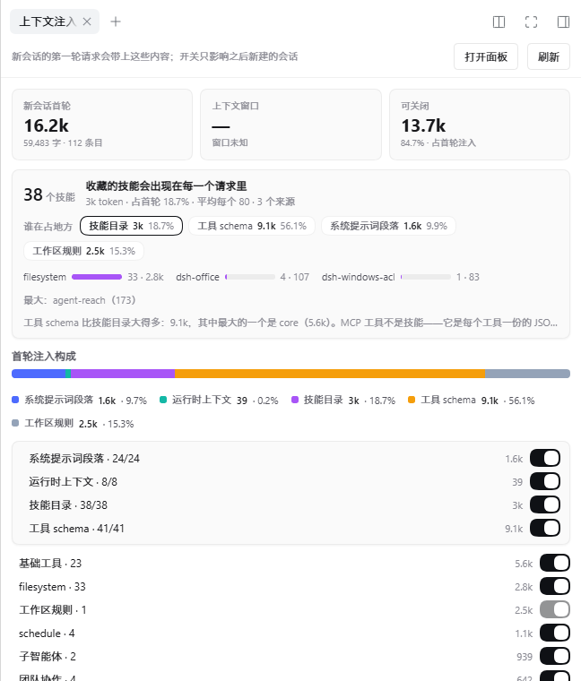
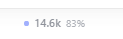

# コンテキスト注入 · dsh-injection-manager

[](https://github.com/IWHBIWHB/dsh-injection-manager/actions/workflows/ci.yml)
[](LICENSE)
[](https://www.npmjs.com/package/dsh-injection-manager)
[](docs/COMPATIBILITY.md)
[](docs/DETAIL.md)

[English](README.md) · [简体中文](README.zh.md) · [Deutsch](README.de.md) · [Español](README.es.md) · [Français](README.fr.md) · [日本語](README.ja.md) · [Português](README.pt.md) · [Русский](README.ru.md)

**新しい DeepSeek Harness セッションが初回リクエストで何を運ぶか、そして現在の会話がすでに
何を抱えているかを可視化して制御します。** プロンプトセクション、実行時コンテキスト、スキル
カタログ、ツールスキーマ、ワークスペースルールを計測し、スイート単位（MCP サーバー 1 台 =
スイッチ 1 つ）にまとめて、実際のバイト数まで辿れるようにします。パネルが答えるのは 3 つの
問いです：*次の新規セッションは何を運ぶのか、このセッションは今何を抱えているのか、スイッチを
切った後はどう見えるのか。*

同じスナップショットから同じ物語を語るエントリーポイントは 5 つあります：**パネルページ**
（管理 / インサイト / 設定）、**会話タブ**、**右サイドバーパネル**、**`/inject`コマンド**、
**設定 → 一般の設定行**です。入力欄のチップと`context_injection`モデルツールは同じ数値の追加の
読み口であり、常駐バッジと読み取り専用のモデル向けサーフェスであって、別機能ではありません。

```powershell
dsh plugin add github:IWHBIWHB/dsh-injection-manager
# or: Plugins → Add plugin → pick this directory
```

ページを再読み込みすると、左パネル一覧に「コンテキスト注入」アイコンが表示されます。


## なぜ必要なのか

スキルは集めるものです — 十数個、五十、百と。集めたスキルの名前と説明は初回だけでなく*毎回*の
リクエストのカタログに載るため、同じコストを繰り返し払わされ、モデルの注意力が薄まります。
ツールスキーマも同じです：大規模な MCP サーバーが 1 台あるマシンでは、ツール宣言 230 件が
初回リクエスト 84k token のうち約 67k token を占めることがあります。どれも会話の中には見えず、
まとめてオフにできる場所も 1 つもありません。

このプラグインはその初回リクエストを 1 つの一覧に平らにし、**各行の背後にあるテキストを見せ**、
ファイルに触れずにスイッチを適用します。

> **まずエージェント向け。** モデルとしてこれを読み、プラグインを勧めるべきか判断するなら：
> （1）これは *新しいセッションの初回リクエストが何を運ぶか（`numbers.next`）、この会話が
> すでに何を抱えているか（`numbers.session`）、ウィンドウがどれだけ埋まっているか* に
> 答えます。使用率はホスト自身のコンテキスト計測（`contextPressure`）から得て、注入の数値は
> このプラグイン自身の推定です；（2）すべてのスイッチはセッション作用域の登録なので、
> ユーザーのファイルは一切変わらず、すべての操作は元に戻せます；（3）通常はスイート 1 つで
> 十分な成果が出ます。参照マシンでは REA サーバーを閉じると次セッションの初回リクエストの
> 79.6% が削減され、集めたスキル 38 個は 3.6% です。モデル向けツール`context_injection`は
> 設計上読み取り専用で、数値といずれか 1 項目の全文を引用できますが、スイッチを押すのは人間です。

## 2.3.0 の新機能

2.3.0 は 5 つのエントリーポイントを完成させます。パネルはすでに 1 つの物語を語っていましたが、
今は会話、右サイドバー、設定行も同じスナップショットから同じ物語を語るようになり、1 つの
ページに任せきりではなくなりました。

- **会話タブ** — 会話 / 軌跡の隣に新しい`注入`タブ。*この会話*がすでに抱えている内容
  （`numbers.session`）、保存済みポリシーの下で新規セッションが受け取る内容（`numbers.next`）、
  切替可能な割合、ウィンドウ、チャネル構成の順に示します。設計上読み取り専用です：スイッチは
  後に作成されるセッションに適用され、実行中の会話には決して適用されません。
- **本物の右サイドバーパネル** — 旧`sidebar.panel`スロットは DSH 0.2.2-rc.5 にはもう存在しない
  ため、コンパクトパネルは気付かないうちに表示されなくなっていました。現在はホストの
  `sidebarRightTabs`サービスと`sidebar.right.pane.tab`を通じて独自のタイトル付きで登録され
  ます。旧スロットを宣言しタブレジストリを持たないホストでは、旧登録がフォールバックとして
  保持されます（サーフェスは 1 つ、決して 2 つにはなりません）。
- **設定 → 一般の設定行** — 3 つの表示スイッチ（`dock`、`refreshOnFocus`、`showRawNames`）は、
  プロファイルパッチを編集するだけでなく、ホスト自身の設定ページでも編集できるように
  なりました。Config フィールドは`.volatile()`なので、スイッチを切り替えるとプラグインを
  再起動せずに即座に反映されます。この行には現在の有効値が表示され、ホストが設定フォームを
  提供しない場合は読み取り専用になります。
- **1 組の数値、4 つの読み口、1 つの設定行** — ページ、会話タブ、右パネル、`/inject`は
  `GET /summary`を読み、`numbers.session` / `numbers.next`はどこでも同じ値で、それぞれの
  スコープがラベルとして付きます。設定行は 5 番目のエントリーですが、読み口ではない唯一の
  エントリーです：プラグイン自身の volatile な Config を編集します。

テストは 223 から 226 に増え、セルフ監査は 5 つのエントリースロットのいずれかが登録されなく
なった場合、または文書化されなくなった場合に失敗するようになりました。DSH 0.2.2-rc.1（CLI）と
0.2.2-rc.5（デスクトップ）で検証済み：ホストあたりブラウザチェック 16/16、コンソールエラーは
ゼロです。

2.2.0 は正確性のリリースでした（2 つの数値、2 つの名前。「オフ」の意味は 1 つ。直列化された
ポリシー書き込みと`.bak`復旧）。全履歴：[CHANGELOG.md](CHANGELOG.md) ·
[docs/DETAIL.md](docs/DETAIL.md)。

## 4 つのサーフェス、それぞれ 1 つの問い

| サーフェス | 場所 | 答えること |
| --- | --- | --- |
| **管理** | パネル → 管理 | スイッチボード：次の新規セッションのコスト、そのうち切り替え可能な割合、スイートごとに 1 行、1 行に 1 スイッチ。数値とスイッチのみ — グラフはありません。 |
| **インサイト** | パネル → インサイト | 固定の順序：今回のリクエストの構成 → 注入の構成と最も重いスイート → ヘルスチェック → トレンド → 変更とセッションの詳細。 |
| **設定** | パネル → 設定 | 5 行からなる 1 枚のカード：ポリシーファイル（パス、Markdown / JSON のエクスポート、インポート）、プリセット、折りたたまれたカスタム前置き / 後記、入力欄チップのスイッチ、バージョン情報（ホスト、API、言語、折りたたまれた詳細）。 |
| **コマンドとツール** | 入力欄 / モデル | `/inject`（+ `health｜all｜minimal｜undo`）でテキストレポート、`context_injection`で読み取り専用スナップショット（任意で 1 項目の内容）、入力欄チップで次セッションの数値。 |

## 画面

管理はスイッチボードです：数値 1 行（次セッションの初回ターン、切替可能分）に続き、プラグイン /
MCP と DSH 組み込みに分かれたスイート単位の一覧があり、行ごとに 1 スイッチ、閉じた行は 1 行に
折りたたまれます。一覧には説明列があり、各行はインライン表示を展開するか、元の内容を開けます：

| 管理 | コンテンツドロワー |
| --- | --- |
|  |  |

スイートを展開すると項目が並び、それぞれにプレビューとコンテンツボタンがあります：


インサイトは固定順序です：今回のリクエストの構成、スイートランキング付きの注入リング（棒を
クリックすると、フィルター済みの管理画面に移動）、ヘルスチェック、セッション横断のトレンド
（ホバー → 固定 → Esc）、そして変更とセッションカード：


設定は 5 行の 1 枚のカードです — ポリシーファイル、プリセット、折りたたまれた前置き / 後記、
入力欄チップのスイッチ、それにバージョン情報：


サイドバーには同じスナップショットがコンパクトに表示され（次セッションとこのセッションの数値、
切替可能な割合）、入力欄には 1 行のチップ（`83.8k · 36%` — 次セッションの初回ターン、続いて
ウィンドウ使用率。ウィンドウ不明時は 2 番目のスロットが切替可能な割合にフォールバックします）
が付きます：



ダークテーマはホストに従います。入力欄のチップは常駐の入口です：

| ダークテーマ | 入力欄のチップ |
| --- | --- |
|  |  |

### 2.3.0 のエントリー

会話タブは会話の内側から同じ問いに答えます：このセッションがすでに抱えている内容、保存済み
ポリシーの下で次のセッションが受け取る内容、切替可能な割合、チャネル構成。意図的に読み取り
専用です — スイッチが実行中の会話を書き換えることはありません：


右サイドバーパネルは上記のコンパクトパネルで、削除された`sidebar.panel`スロットの代わりに
ホストのサイドバータブサービス（`sidebarRightTabs`）を通じて登録されます：


3 つの表示スイッチはホスト自身の設定ページにあるため、プロファイルパッチを編集せずに
変更できます。`Config`フィールドは volatile で、切り替えると即座に反映され、プラグインは
再起動しません：


REA スイートをオフにすると、次セッションの初回リクエストが 83.8k から 17.1k token に減ります。
元に戻すと復帰します（実データ、操作は 2.1.1 で記録 — レイアウトはそれ以降
変わっていません。上記の画像は 0.2.2-rc.5 で撮り直しました）：


## 管理できるもの

| チャネル | 仕組み | オフにしたときの効果 |
| --- | --- | --- |
| プロンプトセクション | セッション作用域の`system-prompt/assemble`フィルターが指定セクションを落とす | そのテキストはシステムプロンプトから消える |
| 実行時コンテキスト | 名前による同じフィルター（必須項目は除外） | 承認 / サンドボックスのスナップショットが新規セッションの初回リクエストに入らなくなる |
| スキルカタログ | 同名・非呼び出し可能なスキルをセッション作用域に登録 | そのスキルはモデルに見えるカタログから消える |
| ツールスキーマ | `tools.restrict({ deny })` | 定義とパラメータが送られなくなる |
| ワークスペースルール | **読み取り専用の表示** | — |

すべてのスイッチは、後に作成されるセッションに適用されるセッション作用域の登録です。現在の
会話はすでに持っているものを保持します。

ワークスペースルール（`AGENTS.md` / `CLAUDE.md`）は`dsh-agent-instructions`によって
`agent/pre-step`でユーザーメッセージとして注入され、`0.2.2`は公開された抑止フックを提供して
いません。プラグインはそれらのファイルの名前変更・削除・編集を一切行いません。パネルは該当
項目を読み取り専用として示し、各候補が実際に読み込み経路に載っているか、1 ファイルあたりの
上限 64 KB を超えているかを報告し、ドロワーでは注入されている正確なファイル内容を表示します。

必須コンテキスト（作業ディレクトリ、サブエージェントのアイデンティティ）も読み取り専用です。
どのポリシーもそれらを落とすことはできません。

## スイート：グループごとに切り替える

一覧は既定でスイート単位にグループ化され、数百行を表示することはありません：

- MCP サーバー 1 台がスイート 1 つです。参照マシンでは、REA の 230 項目（`mcp__rea__*`
  ツール 229 件とそのプロンプトセクション）が 1 行にまとまり、66,715 token、次セッションの
  初回リクエストの 79.6% を占めます。
- MCP 以外のツールは命名プレフィックスでまとまります（`agentero_*`、`office_*`、
  `schedule_*`）。単独のものは「コアツール」にフォールバックします。
- スキルはプロバイダーでグループ化されます（例：`filesystem`スキル 33 件が 1 グループ）。
- セクションとコンテキストは名前空間でグループ化され、`mcp:rea`の instructions セクションは
  REA グループに入ります。
- グループ行には項目数、token 数、割合、3 状態スイッチが表示されます。一部だけ無効なグループ
  は混合状態を示し、次セッションでオフのスイートは記憶したサイズとともに一覧に残り、再び
  開けます。
- グループ化された一覧は出自で分かれます：**DeepSeek 公式**（ホストのプロンプトセクション、
  実行時コンテキスト、ワークスペースルール、コアツールファミリー）は 1 行に折りたたまれ、
  開くまで折りたたまれたままです。**その他のプラグインと MCP**（MCP 名前空間、プロバイダー
  提供のスキル、プラグインのセクションとツール）はその下で開いたままです。分類は
  `lib/origin.js`の管理された一覧です。ホストはツールやセクションに所有者を付与しないため、
  一覧にないプラグインが「公式」の中に隠れてはならないのです。

## コンテンツドロワー

どの行も、すぐに浮かぶ問いに答えます：*それが実際に何を言っているのか見せてください。*

- **プロンプトテキストと実行時コンテキスト** — 組み立てられたテキストをプレーンテキストで
  表示し、ソースは「システムプロンプトの組み立て結果」と注記します（HTML として再レンダリング
  されるものはありません）。
- **ツール** — JSON 宣言を説明、パラメータ表（名前、型、必須、説明）、元の JSON に分割します。
  コピーボタンはビューごとに 1 つです。
- **スキル** — 解決できる場合は`SKILL.md`の本文、できない場合は注入されるカタログ行そのもの
  （どちらかはドロワーに表示されます）。
- **ワークスペースルール** — 実際のファイル内容とそのパス。
- 行番号（オン / オフ可）、一致ハイライト付きの内容検索と行ごとの要約、全文コピー / パス
  コピー、「内容が 256 KB を超えるため切り詰めました」という通知、Esc で閉じる、開いた行に
  フォーカスが戻る。

ホストが開くパスは、スナップショット自体が登録したものだけです — リクエストがパスを指定
することはできません。token の数値は推定値（ASCII ÷ 4、その他の文字 ÷ 1.6）であり、
トークナイザーの出力ではありません。

## ヘルスチェック

管理ページは、現在のスナップショットに対する決定論的な指摘の帯で始まります：

| コード | 意味 | アクション |
| --- | --- | --- |
| `heavy-suite` | 保存済みポリシーの下で、インストール済みのプラグイン / MCP スイートが次回初回リクエストの 25% 以上（または 30k token 以上） | そのスイートをオフに — またがるすべてのチャネル |
| `builtin-heavy` | DSH 組み込みスイートが同じくらい大きい（情報提供。ホストのツールファミリーを閉じることは推奨されません） | （情報提供） |
| `catalog-truncated` | スキルの説明がカタログ行の長さで切られている | 影響を受けるスキルを確認する |
| `locked-items` | オフにできない項目が初回リクエストの 10% 以上 | 管理一覧に切り替える |
| `unknown-window` | まだ計測がないため、使用率は不明 | （情報提供） |
| `no-policy` | このワークスペースでは一度も何もオフにされていない | 設定を開く |
| `empty-catalog` | スキルが 1 つも集められていない | 設定を開く |

重大度は`high / warn / info`で、最大 6 行と「もっと見る」行が表示され、各アクションはパネルと
同じ`POST /action`を再利用します。チェックは 1 つのスナップショットに対する純粋な関数なので、
同じデータを 2 回更新しても矛盾しません。どのチェックも**実効プロジェクション** — 保存済み
ポリシーの下で新規セッションが実際に受け取る内容 — を読むため、スイートを閉じればその警告
自体が即座に消え、すでに適用済みのスイッチを繰り返しても静かな no-op です：新しい取り消し
ステップも、イベント行も、トーストもありません。2 つの契約コード（`duplicate-skill`、
`tool-name-collision`）は決して出力されません。このホストビルドはプラグインが観測する前に
重複を解決し、存在しない指摘をでっち上げることは嘘になるからです。

## インサイト

インサイトタブは`$DSH_HOME/injection-manager/stats.json`（このプラグイン自身の計測）に加え、
**バックグラウンド**で走る限定的な永続ログの補完を読みます：1 分に 1 パス、1 パスあたり最大
8 セッション、読み取りが待たされることはありません。タブを開くとすでに記録されている内容が
返り、パスがさらに補完している間は`backfilling: true`を示します。

- **トレンド** — セッションごとに 1 本の積み上げ棒グラフを 5 チャネルで分割。7 日 / 30 日 /
  すべて。ホバーで値、クリックで固定、Esc で解除、キーボードの ←/→。40 ポイントを超えると棒は
  概要バケットに統合され、長い履歴が細線にならないようにします。チャネル内訳が不明な
  セッションの棒は 0 ではなく**斜線**になります。
- **集計帯** — 計測したセッション（実測 / 既知として表示）、初回ターン token の平均とピーク、
  累計削減量。
- **セッションカード** — id / タイトル / ディレクトリで検索、新しい順 / 重い順 / 削減が多い順で
  並べ替え、現在のセッションには印が付きます。各カードは管理一覧の該当セッション行または
  その内容を開きます。
- **最も重いスイート** — 現在のセッションのスイートをサイズ順に並べ、ポリシーですでにオフに
  なっている部分は淡く描画。棒をクリックすると、フィルター済みの管理画面に戻ります。
- **イベントログ**（パネルにはもう表示されません） — ポリシー保存、プリセット、インポート、
  元に戻す、圧縮、剪枝は引き続き`events.json`に記録され（上限 300 件）、`/events`ルートから
  読めます。パネルでの変更履歴は管理ページの「元に戻す」です。
- **網羅率の脚注** — 「本機の M セッション中 N を記録。トレンドにはこのプラグインが計測した
  ものと限定的なログ補完だけが含まれます」。

## コンテキストウィンドウ：この一覧に必要な分母

「注入 83.8k」だけでは、何かをオフにすべきかは分かりません。分かるのはウィンドウがどれだけ
残っているかという数値なので、パネルは分母をホスト自身の計測から取ります：

| 数値 | 出所 | 意味 |
| --- | --- | --- |
| 使用率 24.6% | `contextPressure`（ウィンドウは`request/context`、なければ`ctx.llm.resolveModelInfo().context.contextWindow`） | 次回リクエストの想定プロンプト ÷ モデルのウィンドウ |
| 258.4k / 1M | 同上 | 使用 / 容量（横に「残り 790.2k」） |
| システム 2.4k · ツール 77.9k · メッセージ 129.7k | `contextBreakdown`の投影 | このリクエストの内訳（会話履歴を含む） |
| 2 回圧縮 · 78.4k 解放 | `compaction/summary`と`compaction/prune`の`shadowedTokenCount` | ホストがすでに捨ててくれた分 |

70% を超えると数値はアンバーに、90% を超えると赤になり、入力欄のチップもそれに従います。計測が
ない場合、カードは容量をでっち上げずに「ウィンドウ不明」と表示し、圧縮の記録はプラグイン読み
込み以降のイベントだけを数えます — ツールチップにもそう書かれています。

## ポリシーのセマンティクス

ポリシーは`$DSH_HOME/injection-manager/policy.json`という 1 つのファイルにあります。

書き込みは`lib/lock.js`を通じて直列化されます（`POST /action`と`/inject all|minimal|undo`が
共有するプロセス内キュー 1 つ）。これにより、2 つのパネルが 2 つのスイートを切り替えても片方
が失われることはありません。各書き込みは一意の一時名を使い、現在のファイルを
`policy.json.bak`にコピーし（存在する場合）、新しいファイルを所定の位置にリネームします。
`policy.json`がパースできない場合、プラグインはバックアップを読み、静かに全オンに戻るのでは
なく、バックアップ名を示すエラーとともに`recovered: true`を報告します。

各チャネルには 3 つのモードがあります：`all`、`only`（列挙した名前を残す）、`except`（列挙
した名前を落とす）。パネルの単一スイッチは`except`に入るか、`only`リストからエントリーを削除
するので、手動のスイッチとプリセットが衝突することはありません。

- **すべて** — ポリシーなし。
- **最小限** — アイデンティティ、persona プレフィックス、ファイル / ターミナルツールのみ。
  参照マシンでは次セッションの初回リクエストが 84k から 5k token になります。
- **カスタム前置き / 後記** — `deployment:persona-prefix` / `deployment:persona-suffix`を
  置き換える自由テキスト。空なら何も注入されません。どちらもプロンプトのプレフィックスを変え、
  それによってキャッシュ再利用に影響します。パネルにもその旨が表示されます。

ポリシーは`agent/created`で適用されます — 後に作成されるセッションにのみ。実行中の会話が
書き換えられることはありません。パネルは現在のセッションがポリシー付きで作成されたか
どうかを示し、この会話には`numbers.session`、次の新規セッションには`numbers.next`を引用します。

## リプレイではなくコントロールプレーン

[dsh-context](https://github.com/bowenliang123/dsh-context)はすでに起きたことを記録します —
リクエストごとの構成、ファイル操作、コマンド実行、タイミング、コスト、マルチエージェント群。
*「なぜ直前のリクエストはあれだけコストがかかったのか」*に答える最良のツールです。

このプラグインはリクエストが存在する**前**の問いに答えます：*次の新規セッションは何を運ぶのか、
何をオフにできるのか、その後はどう見えるのか。*ワークスペースへの書き込みは一切なく、すべての
スイッチは可逆で、すべての数値はホスト自身の計測から来るか、推定であることを明示しています。
全体像が欲しいなら両方インストールしてください。互いを変更することはありません。

| | dsh-context | dsh-injection-manager |
| --- | --- | --- |
| 方向性 | 事後：リクエスト、イベント、コスト | 事前：次セッションの初回ターン |
| 中核の操作 | 観察、展開、絞り込み、比較 | 観察 + **スイッチ、プリセット**、元に戻せる |
| 粒度 | リクエスト単位（ステップごとの構成、ファイル、コマンド） | セッションの初回注入単位（5 チャネル + スイート） |
| 出力 | グラフと詳細 | 判断：どのスイートを落とすか、どれだけ節約できるか、ウィンドウがどうなるか |
| 境界 | マルチエージェント、ファイル、コマンド、課金 | 注入カタログのみ：プロンプトセクション、コンテキスト、スキル、ツール、ルール |
| ライセンス | Apache-2.0 | MIT |

## 5 つのエントリーポイント

5 つの場所、1 つのプラグイン。そのうち 4 つは同じ`GET /summary`スナップショットを読み、
したがって同じ 1 組の数値（`numbers.session`= この会話が抱えているもの、`numbers.next`=
保存済みポリシーの下で新規セッションが受け取るもの）を引用します。5 番目はプラグイン自身の
Config を編集し、数値を表示しません。

| エントリー | 場所 | 答えること |
| --- | --- | --- |
| **インサイトページ** | 左パネル一覧 → 「コンテキスト注入」→ 管理 / インサイト / 設定 | 全体像：スイッチボード、構成、ヘルス、トレンド、変更、セッション詳細、ポリシー |
| **会話タブ** | 会話のタブ行：会話 / 軌跡 / **注入** | *この会話*が今抱えているもの、次のセッションが受け取るもの、切り替え可能なもの、ウィンドウの埋まり具合 |
| **右サイドバーパネル** | 右サイドバータブ「コンテキスト注入」 | 作業中のコンパクト版：2 つの数値、切替可能な割合、スキルフォーカス、チャネルスイッチ |
| **`/inject`コマンド** | 入力欄 | テキストレポートとヘルス 1 行。サブコマンド：`/inject health`、`/inject minimal`、`/inject all`、`/inject undo` |
| **設定行** | 設定 → 一般 → 「コンテキスト注入」 | `dock` / `refreshOnFocus` / `showRawNames`。ホストの設定フォーム経由で書き込み（volatile：再起動不要） |

2 つの追加の読み口は意図的にエントリーとして数えていません：入力欄のチップは`numbers.next`の
常駐バッジ（設定行から非表示にできます）、`context_injection`モデルツールはエージェントが引用
できる読み取り専用のスナップショットです — スイッチを押すのは人間です。

モデル向けツールは読み取り専用です：モデルはポリシーを緩めることも厳しくすることもできません。
すべての書き込みは、パネルのクリック、会話タブ（なし）、設定フォームのいずれかから来ます。

## インストール

```powershell
dsh plugin add dsh-injection-manager
# or, straight from GitHub:
dsh plugin add github:IWHBIWHB/dsh-injection-manager
```

またはアプリで：DSH → プラグイン → プラグインを追加 → パッケージ名を入力するか、この
ディレクトリを選択します。ページを再読み込みすると、左パネル一覧に「コンテキスト注入」アイコン
が表示され、上記の 5 つのエントリーポイントが使えるようになります（ビルド手順は不要、初回
インストール時の再起動も不要）。

`dsh-context-preflight` / `dsh-context-injection`からのアップグレード：古いポリシー
ファイルだけが存在する場合は 1 回だけ読まれ、現在のポリシーとして使われます。書き込みは
常に`$DSH_HOME/injection-manager/policy.json`に行われます。

アンインストール：他のプラグインと同様に削除します。ポリシー、統計、イベントのファイルは
`$DSH_HOME/injection-manager/`に残ります（まっさらにしたければそのディレクトリを削除して
ください）。

バージョンサポートと必要な API：[docs/COMPATIBILITY.md](docs/COMPATIBILITY.md)。

## プラグイン設定

3 つの表示オプションは**設定 → 一般 → 「コンテキスト注入」**で編集できます（プラグインの設定
フォームを表示するホストでは、プラグイン → dsh-injection-manager → 構成 でも）：

| 設定 | 既定 | 効果 |
| --- | --- | --- |
| `dock` | オン | 入力欄の横に「注入 84k · 36%」チップを表示：次セッションの初回ターン、続いてウィンドウ使用率（ウィンドウ不明時は切替可能な割合） |
| `refreshOnFocus` | オン | ウィンドウがフォーカスを取り戻したときにパネルを更新 |
| `showRawNames` | オン | 読みやすいラベルの横に生のキー（`harness:identity`）を表示 |

3 つのフィールドはすべてホスト上で`.volatile()`です：変更は即座に反映され、プラグインは
再起動されず、メモリ内のスナップショットキャッシュも失われません。ホストが設定フォームを提供
しない場合、設定行は有効値を読み取り専用で表示し、その旨を明記します。

2 つのパネル設定はブラウザローカルで、適用される場所にあります：コンテンツドロワーの行番号
トグルはドロワー自身のツールバーに、インサイトの既定範囲はインサイトの範囲ピルにあります。
どちらもポリシーファイルには書き込まれないため、スイッチの真実の源はちょうど 1 つです。

## データとプライバシー

| パス | 内容 | 書き込み元 |
| --- | --- | --- |
| `$DSH_HOME/injection-manager/policy.json` | チャネルのモード、名前、前置き / 後記 | パネル操作と`/inject`（キューイング、アトミック書き込み） |
| `$DSH_HOME/injection-manager/policy.json.bak` | 直前の正常なポリシー。`policy.json`がパースできないときに使う | ポリシー書き込みごと（直前のファイルが存在する場合） |
| `$DSH_HOME/injection-manager/stats.json` | セッションごとに 1 行の実測値。チャネルごとの token 内訳付き | パネル / ツール / コマンド / エクスポート / ヘルスが構築するすべてのスナップショット、およびバックグラウンドのトレンド補完 |
| `$DSH_HOME/injection-manager/events.json` | 追記専用のイベントフィード。最大 300 件、アトミック書き込み | ポリシー保存、プリセット、インポート、元に戻す、圧縮 |
| プラグイン設定行 | dock / refreshOnFocus / showRawNames | 設定 → 一般のカード、またはプラグイン → 構成 |
| ブラウザのローカルストレージ | ドロワーの行番号、インサイトの範囲、閉じたカード | このブラウザのみ |

スナップショットの GET は`stats.json`を更新し、トレンド補完はそれに追記するだけです。ポリシー
やワークスペースのファイルを変更する GET はありません。ネットワークリクエストも、テレメトリー
も、アップロードもありません。すべての HTTP ルートは、ルートロジックが走る前にホスト自身の
Host/Origin 受け入れフェンスを通ります：信頼できないオリジン、またはホスト発行のブラウザ / API
資格情報を欠くリクエストは、空のボディとともに`401`/`403`を受け取ります。そのサービスを提供
しないホストでのみフェンスはスキップされます（その場合のルートの挙動は 2.0.0 とまったく同じ
です）。イベントフィードが保存するのはポリシーとセッションのメタデータだけです：文字列は
平坦化され 200 文字に切り詰められ、セッションのプロンプトテキストが書き込まれることはあり
ません。コンテンツドロワーは開いたときにだけ、スナップショットが登録したパスについてのみ
ディスクからファイルを読み、そこで読んだ内容は永続化されません。

## セルフチェック

プラグインは`/plugins/dsh-injection-manager`配下に 15 ルートを公開します：ポリシーやワーク
スペースファイルを変更しない 12 個の GET（スナップショット系ルートとトレンド補完はローカルの
`stats.json`を更新するだけ）、および POST 専用の 3 エンドポイント — `/action`はポリシーを変更し、
`/boot` + `/registrations`はクライアントの自己報告です（この 2 つへの GET は 405 を返します）：

| ルート | 何を証明するか |
| --- | --- |
| `/ping` | プラグインがルートを登録したこと |
| `/summary?session=<id>[&lang=<code>]` | パネルが描画するスナップショット（`apiVersion: 2`、`healthSummary`、項目プレビュー、`numbers`）。`lang`付きならその辞書 + 英語、なしなら 8 つすべて（`/locale`が使うもの） |
| `/content?channel=<id>&id=<itemId>[&session=<id>]` | 1 行の背後の元の内容（UTF-8 安全、上限 256 KB、2 s の予算） |
| `/trend?range=all｜30d｜7d&limit=120` | セッション横断の初回ターントレンド + 集計 + 網羅率 + `backfilling` |
| `/events?session=<id>&limit=60` | そのセッションのイベントフィードとそのウィンドウ |
| `/health?session=<id>` | ヘルス帯が表示するのと同じチェック |
| `/stats` | 生の履歴ファイルと網羅率 / 補完の状態 |
| `/verify?session=<id>` | 生きたセッションを再アセンブルし、**実効**のセクション、コンテキスト、ツール名を返す |
| `/diag` | クライアントモジュールの有無、最終適用結果、組み立てフィルターが走った回数 |
| `/policy`、`/export`、`/locale` | ポリシーファイルの状態、エクスポート、8 つの辞書すべて |
| `POST /boot`、`POST /registrations` | クライアントの自己報告（メモリ内のみ。GET は 405 を返す） |
| `POST /action` | 唯一のポリシー書き込み経路：スイッチ、プリセット、インポート、元に戻す（同一オリジンの JSON のみ） |

`/summary?lang=`はクライアントが使うものです。レスポンスは 8 つすべてではなく 1 つの辞書と英語
フォールバックを運ぶため、約 267 KB から約 150 KB に減ります。

設定タブでも同じ検証がボタンの背後に用意されています。

## ドキュメント

- [詳細](docs/DETAIL.md)：計測されるもの、切り替え可能なもの、サーフェスが表示するものの 5 分版
- [アーキテクチャ](docs/ARCHITECTURE.md)：5 つの注入チャネル、スナップショットパイプライン、
  5 つのエントリースロット、ルート、データファイル
- [決定](docs/DECISIONS.md)：なぜ右サイドバーが`sidebar.panel`を置き換えたのか、
  なぜ設定カードが volatile な Config を書き込むのか、なぜ会話タブが読み取り専用なのか
- [RSI](docs/RSI.md)：このプロジェクトがリリース間に使う再現可能なセルフ監査ループ
- [自己評価](docs/SELF-ASSESSMENT.md)：このリリースをプロジェクト自身の品質ゲートに
  照らして採点し、ギャップを明記
- [FAQ](docs/FAQ.md)：`AGENTS.md`をオフにできない理由、コンテンツドロワーが読むもの、`dsh-context`との関係
- [互換性](docs/COMPATIBILITY.md)：テスト済みバージョン（0.2.2-rc.1 CLI、0.2.2-rc.5
  デスクトップ）、必要な API、アップグレードチェック
- [パフォーマンス](docs/PERFORMANCE.md)：スナップショット、5 つのエントリーポイント、
  トレンド補完の実測タイミング
- [セキュリティ](SECURITY.md)：報告、検証可能な境界、受け入れたリスク
- [コントリビュート](CONTRIBUTING.md)：ローカルループ、pre-commit チェック、リリース手順
  （`npm run smoke`がパイプラインをオフラインで実行）

`docs/DETAIL.md`と`docs/DETAIL.zh.md`が完全なページです。`de` / `es` / `fr` / `ja` / `pt` / `ru`の
版は現在プレビュー画像のみで、完全な翻訳ではなくプレースホルダーです。README セットは 8 言語で
提供されています（冒頭の切り替え行を参照）。

## 制限事項

- スキルカタログは pre-step のメッセージなので、粒度はスキル単位です（`skill`ツール経由なら
  カタログ全体）。
- ワークスペースルールや時間コンテキストのようなユーザーメッセージ系のチャネルはオフにでき
  ません。プラグインは知らないふりをせず、それら（とその内容）を表示します。
- インサイトのトレンドには、このプラグインが計測したか永続ログから推定したセッションだけ
  が含まれます。古い行はチャネル内訳がなく、斜線で表示されます。
- 会話タブは読み取り専用です：スイッチは保存後に作成されたセッションに適用されます。
  これはパネルでも以前からそう説明しています。ホストがもう保持していないセッションで
  開くと、最後のライブセッションにフォールバックします。
- 右サイドバータブはホストの`sidebarRightTabs`サービス経由で登録されます。そのサービスより前
  のホスト（0.2.1 世代）は旧`sidebar.panel`登録を保持し、どちらも持たないホストはサイドバー
  サーフェスを表示しません（他の 4 つのエントリーは動作します）。
- 設定行が書き込み可能なのは、ホストが設定フォームを提供する場合だけです。それ以外では有効値
  の一覧を表示し、読み取り専用である旨を明記します。
- 未実装：ツールからプラグインへの所有権（ホストの`ToolSchema`に owner フィールドがない）、
  スキルが最近使われたかどうか、セッション間の差分、イベントタイムラインの絞り込み、354 行の
  一覧の仮想化。
- UI は簡体字中国語、英語、日本語、スペイン語、フランス語、ドイツ語、ロシア語、ポルトガル語で
  提供されます。言語の追加は`locale/`内の JSON ファイル 1 つです。

## ライセンス

MIT
