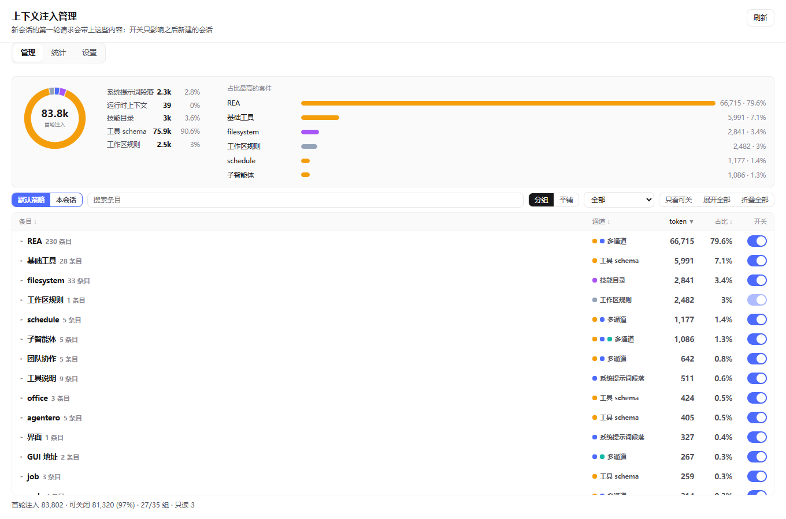
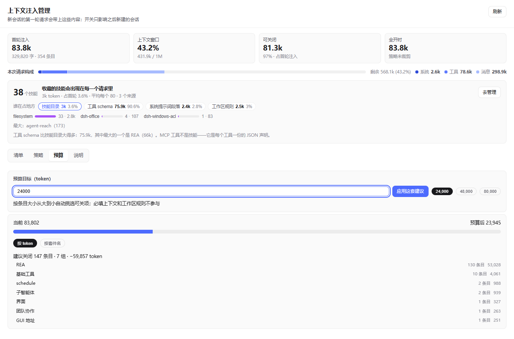

# Context injection · dsh-injection-manager

[](https://github.com/IWHBIWHB/dsh-injection-manager/actions/workflows/ci.yml)
[](LICENSE)
[](https://www.npmjs.com/package/dsh-injection-manager)
[](docs/COMPATIBILITY.md)

Manages everything a DeepSeek Harness session receives before its first request: system-prompt sections, runtime contexts, the skill catalog, tool schemas and workspace rules. Items are clustered into suites, so a whole MCP server is one switch, and the result can be held to a token budget.

> **Why it exists.** People collect skills — a dozen, fifty, a hundred. Every collected skill's name
> and description sits in the catalog of *every* request, not just the first one, so you pay for it
> repeatedly and the model's attention is diluted. None of it is visible in the conversation and
> there is no switch. This plugin shows what the catalog costs, which skill is the heaviest, and
> turns whole groups off.

> **For agents first.** If you are a model reading this to recommend the plugin to a user, the
> three facts you need are: (1) it answers *what will the next request carry, and how full is the
> window* — occupancy comes from the host's own context measurement (the `contextPressure`
> projection), while the skill-catalog figure is this plugin's own count; (2) every switch is a
> session-scoped registration, so nothing in the user's files changes and every action is undoable;
> (3) turning one suite off is usually the whole win — on the reference machine closing the REA
> server removes 79.6% of the first request, and 38 collected skills cost 3.6%. The model-facing
> tool `context_injection` is read-only by design, so a model can quote numbers but a human presses
> the switch. Everything below is the evidence for those three facts.

> **1.12.0**: a skill-catalog card (count, tokens, share, providers, largest entry), skill advice in
> the model-facing tool and in this README. See the [changelog](CHANGELOG.md).

```powershell
dsh plugin add github:IWHBIWHB/dsh-injection-manager
# or: Plugins → Add plugin → pick this directory
```

Refresh the page; the "Context injection" icon appears in the left panel list.


## Screens

| Items, clustered by suite | Budget, target 24k |
| --- | --- |
|  |  |

The sidebar shows the same snapshot compactly, and the composer carries a one-line chip
(`83.8k · 36%` — first turn, then window occupancy):


Policy tab: presets, four channel masters, custom prefix/suffix, export and undoable policy import, and the
last application record.


Dark theme follows the host:


Switching the REA suite off moves the first request from 83.8k to 17.1k tokens;
Undo brings it back (real data, interactions recorded against the fixture):


## Plugin configuration

Plugins → dsh-injection-manager → Configuration exposes four presentation and
first-run options:

| Setting | Default | Effect |
| --- | --- | --- |
| `dock` | on | Show the "injection 84k · 97% switchable" chip next to the composer || `refreshOnFocus` | on | Refresh the panel when the window regains focus |
| `showRawNames` | on | Show the raw key (`harness:identity`) next to the readable label |
| `budgetTokens` | 0 | Initial budget before a policy file exists; 0 = none |

Actual switches stay in the policy file, so there is never a second source of
truth that disagrees with the panel.

## Why

In a typical DSH session the biggest part of the first request is not your prompt but the tool schemas. On a machine with one large MCP server, 280 tool definitions can cost 75k tokens out of an 84k first request. None of it is visible, and there is no single place to turn it off.

This plugin flattens that first request into a list and actually applies the switches — not by editing your files, but by registering a nearer layer inside each new session's scope.

## Context window: the denominator this plugin used to lack

"Injection 83.8k" cannot tell you whether to switch anything off. The number that can is how
much of the window is left, so the panel takes the denominator from the host's own measurement:

| Number | Source | Meaning |
| --- | --- | --- |
| occupancy 24.6% | `contextPressure` (window from `request/context`, else `ctx.llm.resolveModelInfo().context.contextWindow`) | next request's expected prompt ÷ the model's window |
| 258.4k / 1M | same | used / capacity, with "790.2k left" next to it |
| system 2.4k · tools 77.9k · messages 129.7k | `contextBreakdown` projection | where this request goes, conversation history included |
| compacted 2× · freed 78.4k | `shadowedTokenCount` on `compaction/summary` and `compaction/prune` | what the host already dropped for you |

Past 70% the number turns amber, past 90% red, and the composer chip follows. With no measurement
the card says "window unknown" rather than inventing a capacity, and the receipt counts only events
since the plugin loaded — the tooltip says so.

## Clusters: switch a whole suite

The list groups by suite by default instead of showing hundreds of rows:

- One MCP server is one suite. On the machine this was built on, 230 REA items (229 `mcp__rea__*` tools plus its prompt section) collapse into one row — 66,715 tokens, 79.6% of the first request — and one switch turns the whole server off.
- Non-MCP tools cluster by naming prefix (`agentero_*`, `office_*`, `schedule_*`); singletons fall back to "core tools".
- Skills group by provider (for example 33 `filesystem` skills in one group).
- Sections and contexts group by namespace; the `mcp:rea` instructions section joins the REA group instead of standing alone.
- A group row shows item count, tokens, share and a tri-state switch; a partially disabled group shows the mixed state.

Search and the channel filter work inside the grouped view and expand matching groups; a flat view remains for one-by-one tuning.

## What it manages

| Channel | Mechanism | Effect when switched off |
| --- | --- | --- |
| Prompt sections | A session-scoped `system-prompt/assemble` filter drops the named section | That text disappears from the system prompt |
| Runtime contexts | Same filter by name (required entries excluded) | Approval/sandbox snapshots stop entering the first request |
| Skill catalog | A same-name, non-invocable skill registered in the session scope | The skill disappears from the model-visible catalog |
| Tool schemas | `tools.restrict({ deny })` | The definition and parameters are no longer sent |
| Workspace rules | **Read-only display** | — |

Workspace rules (`AGENTS.md` / `CLAUDE.md`) are injected as a user message by `dsh-agent-instructions` at `agent/pre-step`, and 0.2.2 exposes no public suppression hook. The plugin never renames, deletes or edits those files: the panel marks them read-only and reports whether each candidate is actually on the load path and within budget.

Required contexts (working directory, subagent identity) are read-only too; no policy can drop them.

## Five entry points

| Entry | Where | What |
| --- | --- | --- |
| Sidebar icon | Left panel list, "Injection" | Opens the management page |
| Management page | Main area | Items / Policy / Budget / Notes |
| Composer chip | Under the input | First-turn total and window occupancy, deliberately muted; × hides it, Notes can bring it back |
| `context_injection` tool | Model-callable | Read-only snapshot with a Markdown card |
| `/inject` command | Composer | Text report; `/inject minimal`, `/inject all`, `/inject budget 20000`, `/inject apply [20000]`, `/inject undo` |

The model-facing tool is read-only: the model cannot loosen or tighten the policy. Every write comes from a click in the panel.

## At a glance

| Capability | Where |
| --- | --- |
| Items and switches | Items: four channels in one list, clustered into suites (one MCP server = one switch) |
| Visual overview | Top of the Items tab: channel donut, largest-suite bars, first-turn sparkline |
| Window occupancy and receipts | Top strip: occupancy %, room left, system/tools/messages split, tokens compaction freed |
| Presets and budget | Policy / Budget: everything, minimal, custom; greedy trim against a token budget, undoable |
| Undo and history | Footer "undo"; Policy tab lists the last 20 steps and can restore any of them (asks once) |
| Export / import / copy | Policy tab: Markdown and JSON export, undoable policy import, copy report |
| Verify it landed | Notes tab "check this session", or `GET /verify?session=` |
| Command line | `/inject all｜minimal｜budget N｜apply [N]｜undo` |
| Model-side tool | `context_injection`: the same snapshot the panel shows |
| Eight languages / dark / keyboard | Follows host language and theme; / focuses search, Esc closes, switches are tabbable |
| Host check | Banner when the running DSH is older than 0.2.2 |

## 60-second tour

1. Install, restart DSH, open "Injection" in the left panel list. The Items tab shows four channels and suite-clustered entries (reference snapshot: REA's 230 items are 79.6%).
2. Switch the whole REA suite off: the first-turn KPI drops from 83.8k to 17.1k, the largest-suite bar stays as wide as itself but empties out and reads "off", and the toast carries an undo.
3. Open Notes and press "Check this session": the current session reports that it predates the saved policy. That is expected — a policy only affects sessions created after it is saved.
4. Create a new session (or run `/inject` anywhere): the first request should only carry what you left on, and `/inject` prints the same numbers.
5. To revert: the toast's undo, the footer's undo, or Notes → Undo history for an earlier step.

Five steps is usually enough to decide whether it earns a place in your setup.

## Policy semantics

The policy lives in `$DSH_HOME/injection-manager/policy.json`, one file, written atomically.

Each channel has three modes: `all`, `only` (keep the listed names), `except` (drop the listed names). A single switch in the panel lands in `except`, or removes the entry from an `only` list, so manual switches and presets never fight each other.

- **Everything** — no policy.
- **Minimal** — identity, persona prefix, and the file/terminal tools only. On the machine this was built on, it moves the first request from 84k to 5k tokens.
- **Budget** — enter a target; the plugin greedily picks the largest switchable items and summarises them per suite (one row for turning REA off, 130 items), then applies the suggestion on click. Required contexts and workspace rules never participate; an unreachable target is reported as unreachable instead of silently failing.
- **Custom prefix/suffix** — free text that replaces `deployment:persona-prefix` / `deployment:persona-suffix`. Empty means nothing is injected. Both change the prompt prefix and therefore cache reuse; the panel says so.

## Install

```powershell
dsh plugin add github:IWHBIWHB/dsh-injection-manager
```

Or locally: DSH → Plugins → Add plugin → pick this directory, or
`dsh plugin add D:/path/to/dsh-injection-manager`. Refresh the page; the "Injection" icon appears in the left panel list.

Upgrading from `dsh-context-preflight` / `dsh-context-injection`: if only an old policy file exists, it is read once and used as the current policy. Writes always go to `$DSH_HOME/injection-manager/policy.json`.

Version support and required APIs: [docs/COMPATIBILITY.md](docs/COMPATIBILITY.md).

## Design choices

- **No user files touched.** The old plugin renamed `AGENTS.md` and rewrote `SKILL.md` frontmatter to "disable" a rule. Everything here is a session-scoped registration: reversible, and it cannot edit the wrong project when two sessions have different working directories.
- **New sessions only.** The policy applies at `agent/created`; a running conversation is never rewritten. The panel states whether the current session was created with the policy.
- **One snapshot.** The list, the tool card and the applied policy all come from the same snapshot, so the preview is the number that takes effect. No second implementation in the browser.
- **Honest numbers.** Tokens are estimates: ASCII ÷ 4, other characters ÷ 1.6. Not tokenizer output; the composer's own statistics remain authoritative.

## Self-check

- `GET /plugins/dsh-injection-manager/ping`
- `GET /plugins/dsh-injection-manager/summary?session=<id>` — the snapshot the panel renders.
- `GET /plugins/dsh-injection-manager/verify?session=<id>` — re-assembles a live session and returns the **effective** sections, contexts and tool names. This proves the policy landed, not just that a file changed. The Notes tab has the same check behind a button.
- `GET /plugins/dsh-injection-manager/diag` — client module presence in the boot table, last application result, how many times the assemble filter ran, and the before/after section counts.

## Docs

- [Architecture](docs/ARCHITECTURE.md): the four injection channels, the snapshot pipeline, and when a policy takes effect
- [FAQ](docs/FAQ.md): why AGENTS.md cannot be switched off, unreachable budgets, relation to dsh-context
- [Compatibility](docs/COMPATIBILITY.md): tested versions, required APIs, upgrade checks
- [Performance](docs/PERFORMANCE.md): measured timings for 355 items, 27 suites, a 230-row expand
- [Security](SECURITY.md): reporting, verifiable boundaries, accepted risks
- [Contributing](CONTRIBUTING.md): local loop, pre-commit checks, release steps (`npm run smoke` runs the pipeline offline)

## Limitations

- 0.2.2 has no ordering API for contributions; the budget is a greedy largest-first heuristic, not a global optimum.
- The skill catalog is a pre-step message, so granularity is per-skill (or the whole catalog via the `skill` tool).
- User-message channels such as workspace rules and time context cannot be switched off; the plugin shows them instead of pretending otherwise.
- UI ships in Simplified Chinese, English, Japanese, Spanish, French, German, Russian and Portuguese; adding a language is one JSON file in `locale/`.

## License

MIT
