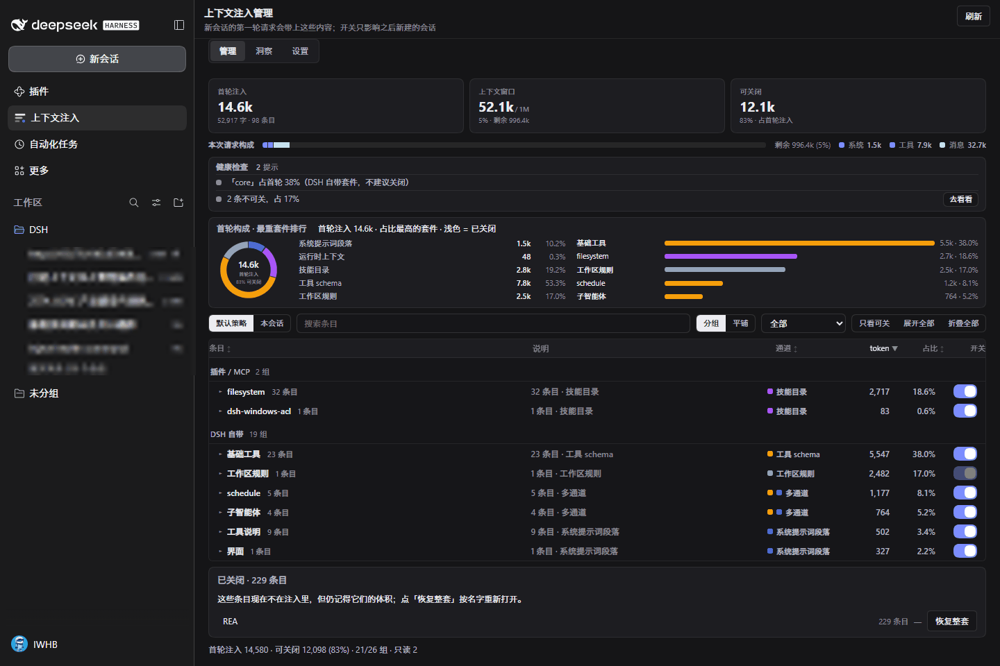
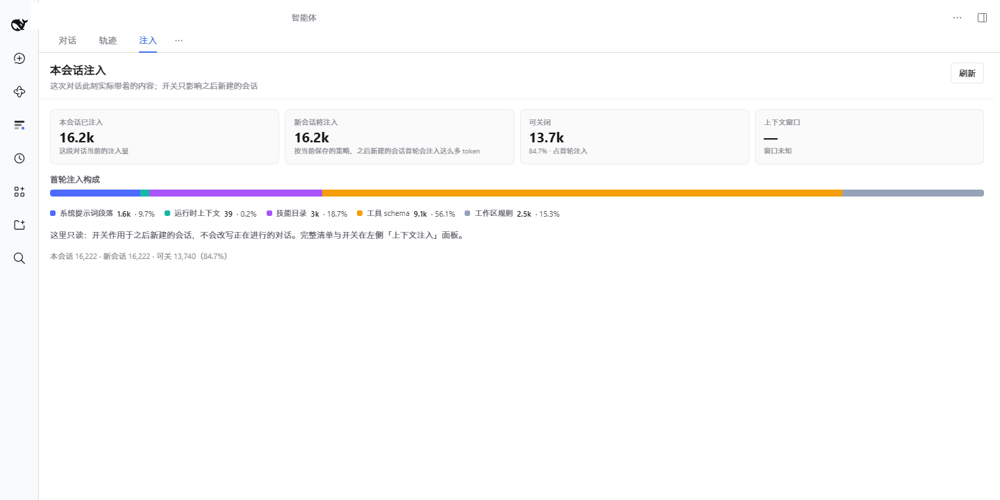

# Context injection · dsh-injection-manager

[](https://github.com/IWHBIWHB/dsh-injection-manager/actions/workflows/ci.yml)
[](LICENSE)
[](https://www.npmjs.com/package/dsh-injection-manager)
[](docs/COMPATIBILITY.md)
[](docs/DETAIL.md)

[English](README.md) · [简体中文](README.zh.md) · [Deutsch](README.de.md) · [Español](README.es.md) · [Français](README.fr.md) · [日本語](README.ja.md) · [Português](README.pt.md) · [Русский](README.ru.md)

**See and control what a new DeepSeek Harness session carries on its first request — and what the
current conversation is already carrying.** Prompt sections, runtime contexts, the skill catalog,
tool schemas and workspace rules are measured, clustered into suites (one MCP server = one switch),
and browsable down to the real bytes. The panel answers three questions: *what will the next new
session carry, what is this session carrying now, and what does any of it look like after a switch?*

Five entry points tell that one story from the same snapshot: the **panel page** (Manage / Insights /
Settings), the **conversation tab**, the **right-sidebar panel**, the **`/inject` shortcut** and the
**preference row in Settings → General**. The composer chip and the `context_injection` model tool are
extra readings of the same numbers — an ambient badge and a read-only model surface, not separate
features.

```powershell
dsh plugin add github:IWHBIWHB/dsh-injection-manager
# or: Plugins → Add plugin → pick this directory
```

Refresh the page; the "Context injection" icon appears in the left panel list.


## Why it exists

People collect skills — a dozen, fifty, a hundred. Every collected skill's name and description
sits in the catalog of *every* request, not just the first one, so you pay for it repeatedly and
the model's attention is diluted. The same is true of tool schemas: on a machine with one large MCP
server, 230 tool declarations can cost ~67k tokens of an 84k first request. None of it is visible
in the conversation, and there is no single place to turn any of it off.

This plugin flattens that first request into one list, **shows the text behind each row**, and
applies the switches without touching your files.

> **For agents first.** If you are a model reading this to decide whether to recommend the plugin:
> (1) it answers *what a new session's first request will carry (`numbers.next`), what this
> conversation already carries (`numbers.session`), and how full the window is* — occupancy comes
> from the host's own context measurement (`contextPressure`), while the injection figures are this
> plugin's own estimate; (2) every switch is a session-scoped registration, so nothing in the
> user's files changes and every action is undoable; (3) one suite is usually the whole win — on
> the reference machine closing the REA server removes 79.6% of the next session's first request,
> and 38 collected skills cost 3.6%. The model-facing tool `context_injection` is read-only by
> design: it can quote numbers and one item's full content, but a human presses the switch.

## What's new in 3.0.0

2.x answered "what will a new session be given, and which of it can I switch off". 3.0 answers the
harder question: **what did this request actually inject, item by item, and who owns it.**

- **Injection ledger (台账)** — a fourth panel tab with one record per model request, captured at the
  host's `system-prompt/assemble` waterfall instead of being re-derived from services. Each record
  shows the prompt sections, runtime contexts and tool schemas that were admitted, the ones the saved
  policy blocked (offered − admitted), the message-level injections of that step (skill catalog,
  AGENTS.md, time, plan/goal/reminders, compaction summary), and its estimated token split.
- **Exact text per item** — sections/contexts are stored content-addressed (`ledger-text/`), so the
  panel can show the exact bytes that request carried, and the same text only exists once. Message-level
  content stays preview-only on purpose: conversation text does not go into the plugin's files.
- **Attribution for everything** — every row carries an owner (registering package), a controllability
  badge (`plugin` / `protected` / `preview` / `user`) and the host source line it comes from; rows with
  no catalog entry are reported as unknown instead of being claimed as switchable.
- **The boundary stated in the UI** — a resident reference card lists the injected content this plugin
  cannot control (time, tmux, plan/goal notices, AGENTS.md, skill catalog, compaction summary) and how
  the user changes each one.
- **Tool mode** — `context_injection {ledger:true}` returns the last requests; `{ledger:true,
  entry:"<id>"}` returns one request's item list.

Read [the panorama](docs/INJECTION-PANORAMA.md) for the source-level mechanism (six injection
surfaces, order tables, precedence rules, what is controllable at all) and
[the v3 design](docs/DESIGN-v3.md) for how the ledger is captured.

## What's new in 2.3.0

2.3.0 completes the five entry points. The panel already told one story; now the conversation, the
right sidebar and the settings row tell the same story from the same snapshot instead of leaving it
to one page.

- **Conversation tab** — a new `注入` tab next to 对话 / 轨迹. It leads with what *this conversation*
  is already carrying (`numbers.session`), then what a new session would get under the saved policy
  (`numbers.next`), the switchable share, the window, and the channel composition. Read-only by
  design: switches apply to sessions created later, never to a running conversation.
- **A real right-sidebar panel** — the old `sidebar.panel` slot no longer exists in DSH 0.2.2-rc.5,
  so the compact panel silently stopped appearing. It now registers through the host's
  `sidebarRightTabs` service and `sidebar.right.pane.tab`, with its own title. On hosts that still
  declare the old slot and no tab registry, the old registration is kept as a fallback (one surface,
  never two).
- **Preference row in Settings → General** — the three presentation switches (`dock`,
  `refreshOnFocus`, `showRawNames`) are now editable in the host's own settings page, not only by
  editing the profile patch. The Config fields are `.volatile()`, so flipping a switch applies
  immediately without restarting the plugin; the row shows the current effective values and is
  read-only where the host does not serve a config form.
- **One pair of numbers, four readings, one settings row** — the page, conversation tab, right
  panel and `/inject` read `GET /summary`, so `numbers.session` / `numbers.next` are the same values
  everywhere, each labelled with its scope. The settings row is the fifth entry but the only one that
  is not a reading: it edits the plugin's own volatile Config.

Tests grew from 223 to 226 and the self-audit now fails if any of the five entry slots stops being
registered or stops being documented. Verified on DSH 0.2.2-rc.1 (CLI) and 0.2.2-rc.5 (Desktop):
16/16 browser checks per host, zero console errors.

2.2.0 was the correctness release (two numbers, two names; one meaning for "closed"; serialized policy
writes with `.bak` recovery). Full history: [CHANGELOG.md](CHANGELOG.md) · [docs/DETAIL.md](docs/DETAIL.md).

## Four surfaces, one question each

| Surface | Where | What it answers |
| --- | --- | --- |
| **Manage** | Panel → 管理 | A switchboard: what the next new session costs, how much of it is switchable, one row per suite, one switch per row. Numbers and switches only — no charts. |
| **Insights** | Panel → 洞察 | One fixed order: this request's composition → injection composition and heaviest suites → health checks → trend → changes and session detail. |
| **Settings** | Panel → 设置 | One card of five rows: the policy file (path, export Markdown/JSON, import), the presets, a folded custom prefix/suffix, the composer-chip switch, and about (host, API, language, folded details). |
| **Commands & tools** | Composer / model | `/inject` for a searchable switch list (open panel, presets, undo, per-suite toggles), `context_injection` for a read-only snapshot (optionally one item's content), and the composer chip for the next-session number. |

## Screens

Manage is a switchboard: one line of numbers (next-session first turn, switchable), then the
suite-clustered list split into Plugins / MCP and DSH built-in, one switch per row, with the closed
rows folded into a single line. The list carries a description column, every row can expand an
inline preview or open its original content:

| Manage | Content drawer |
| --- | --- |
|  |  |

A suite expands to its items, each with a preview and a content button:


Insights has one fixed order: this request's composition, the injection ring with the suite ranking
(click a bar to land on Manage already filtered), health checks, the cross-session trend
(hover → pin → Esc), then changes and session cards:


Settings is one card of five rows — the policy file, the presets, the folded prefix/suffix, the
composer-chip switch, and about:


The sidebar shows the same snapshot compactly (next-session and this-session numbers, switchable
share), and the composer carries a one-line chip (`17.1k · 85%` — next session's first turn, then
window occupancy; the second slot falls back to the switchable share when the window is unknown):


Dark theme follows the host; the composer chip is the ambient entry:

| Dark theme | Composer chip |
| --- | --- |
|  |  |

### The 2.3.0 entries

The conversation tab answers the same question from inside a conversation: what this session is
already carrying, what the next session would carry under the saved policy, the switchable share and
the channel composition. It is read-only on purpose — a switch never rewrites a running conversation:



The right-sidebar panel is the compact panel above, now registered through the host's sidebar tab
service (`sidebarRightTabs`) instead of the removed `sidebar.panel` slot:


The three presentation switches live in the host's own settings page, so they can be changed without
editing the profile patch. `Config` fields are volatile: toggling one applies immediately and does not
restart the plugin:


Switching a suite off moves the next session's first request from 17.1k to 14.3k tokens; Undo
brings it back (real data; every screenshot and the GIF were captured on 0.2.2-rc.5 in an isolated
QA profile):


## What it manages

| Channel | Mechanism | Effect when switched off |
| --- | --- | --- |
| Prompt sections | A session-scoped `system-prompt/assemble` filter drops the named section | That text disappears from the system prompt |
| Runtime contexts | Same filter by name (required entries excluded) | Approval/sandbox snapshots stop entering a new session's first request |
| Skill catalog | A same-name, non-invocable skill registered in the session scope | The skill disappears from the model-visible catalog |
| Tool schemas | `tools.restrict({ deny })` | The definition and parameters are no longer sent |
| Workspace rules | **Read-only display** | — |

Every switch is a session-scoped registration applied to sessions created afterwards; the current
conversation keeps what it already has.

Workspace rules (`AGENTS.md` / `CLAUDE.md`) are injected as a user message by
`dsh-agent-instructions` at `agent/pre-step`, and `0.2.2` exposes no public suppression hook. The
plugin never renames, deletes or edits those files: the panel marks them read-only, reports whether
each candidate is actually on the load path and whether it exceeds the 64 KB per-file cap, and — in
the drawer — shows the exact file content that is being injected.

Required contexts (working directory, subagent identity) are read-only too; no policy can drop them.

## Suites: switch a whole group

The list groups by suite by default instead of showing hundreds of rows:

- One MCP server is one suite. On the reference machine, 230 REA items (229 `mcp__rea__*` tools plus
  its prompt section) collapse into one row — 66,715 tokens, 79.6% of the next session's first
  request.
- Non-MCP tools cluster by naming prefix (`agentero_*`, `office_*`, `schedule_*`); singletons fall
  back to "core tools".
- Skills group by provider (for example 33 `filesystem` skills in one group).
- Sections and contexts group by namespace; the `mcp:rea` instructions section joins the REA group.
- A group row shows item count, tokens, share and a tri-state switch; a partially disabled group
  shows the mixed state, and a suite that is off for the next session stays in the list with its
  remembered size so it can be reopened.
- The grouped list splits by origin: **DeepSeek official** (host prompt sections, runtime contexts,
  workspace rules, core tool families) folds into one line and stays folded until you open it;
  **Other plugins & MCP** (MCP namespaces, provider-backed skills, plugin sections and tools) stays
  open below it. The classification is a maintained list in `lib/origin.js`, because the host does
  not tag a tool or a section with its owner — an unlisted plugin must never hide inside "official".

## The content drawer

Every row can answer the obvious follow-up: *show me what that actually says.*

- **Prompt text and runtime contexts** — the assembled text, as plain text, with the source noted
  as "assembled from the system prompt" (nothing is re-rendered as HTML).
- **Tools** — the JSON declaration split into a description, a parameter table (name, type,
  required, description) and the raw JSON; one copy button per view.
- **Skills** — the `SKILL.md` body when it can be resolved, otherwise the exact catalog line that
  is injected (and the drawer says which one it is).
- **Workspace rules** — the real file content, with its path.
- Line numbers (toggleable), in-content search with match highlighting and a per-line summary, copy
  full text / copy path, a "content is longer than 256 KB, truncated" notice, Esc to close, focus
  returns to the row you opened it from.

The only paths the host will open are the ones the snapshot itself registered — the request cannot
name a path. Token figures are estimates (ASCII ÷ 4, other characters ÷ 1.6), not tokenizer output.

## Health checks

The manage page opens with a deterministic strip of findings over the current snapshot:

| Code | Meaning | Action |
| --- | --- | --- |
| `heavy-suite` | An installed plugin / MCP suite is ≥25% of the next first request under the saved policy (or ≥30k tokens) | Switch that suite off — every channel it spans |
| `builtin-heavy` | A DSH built-in suite is that big (informational; closing host tool families is not recommended) | (informational) |
| `catalog-truncated` | Skill descriptions are being cut at the catalog line length | Read the affected skill |
| `locked-items` | Items that cannot be switched off are ≥10% of the first request | Switch to the manage list |
| `unknown-window` | No measurement yet, so occupancy is unknowable | (informational) |
| `no-policy` | Nothing has ever been switched off in this workspace | Open settings |
| `empty-catalog` | No skills are collected at all | Open settings |

Severity is `high / warn / info`; up to six rows are shown with a "more" line, and every action
reuses the same `POST /action` the panel uses. Checks are a pure function of one snapshot, so two
refreshes of the same data cannot disagree. Every check reads the **effective projection** — what a
new session would actually get under the saved policy — so closing a suite makes its own warning go
away immediately, and repeating a switch that is already applied is a silent no-op: no new undo
step, no event row, no toast. Two contract codes (`duplicate-skill`,
`tool-name-collision`) are never emitted: this host build resolves duplicates before the plugin can
observe them, and inventing a finding would be a lie.

## Insights

The 洞察 tab reads `$DSH_HOME/injection-manager/stats.json` (this plugin's own measurements) plus a
bounded durable-log backfill that runs **in the background**: one pass per minute, at most 8
sessions per pass, never awaited by a read. Opening the tab returns what is already recorded and
flags `backfilling: true` while a pass fills in more.

- **Trend** — one stacked bar per session, split by the five channels; 7 days / 30 days / all; hover
  for values, click to pin, Esc to unpin, ←/→ by keyboard. Above 40 points the bars merge into
  overview buckets so a long history does not turn into hairlines. Bars for sessions whose channel
  split is unknown are **striped**, not zeroed.
- **Aggregate band** — sessions measured (shown as measured / known), average and peak first-turn
  tokens, cumulative saved.
- **Per-session cards** — search by id/title/directory, sort by recent / heaviest / most saved,
  current session marked; every card opens that session's row in the manage list or its content.
- **Heaviest suites** — the current session's suites by size, with the part the policy already
  switched off drawn lighter; a bar jumps back to Manage already filtered.
- **Event log** (no longer surfaced in the panel) — policy saves, presets, imports, undos,
  compactions and prunes are still recorded in `events.json` (capped at 300) and stay readable
  through the `/events` route; in the panel, the change history is 撤销上一步 on the manage page.
- **Coverage footnote** — "recorded N of M sessions on this machine; the trend only contains what
  this plugin measured and a bounded log backfill."

## Context window: the denominator this list needs

"Injection 83.8k" cannot tell you whether to switch anything off. The number that can is how much
of the window is left, so the panel takes the denominator from the host's own measurement:

| Number | Source | Meaning |
| --- | --- | --- |
| occupancy 24.6% | `contextPressure` (window from `request/context`, else `ctx.llm.resolveModelInfo().context.contextWindow`) | next request's expected prompt ÷ the model's window |
| 258.4k / 1M | same | used / capacity, with "790.2k left" next to it |
| system 2.4k · tools 77.9k · messages 129.7k | `contextBreakdown` projection | where this request goes, conversation history included |
| compacted 2× · freed 78.4k | `shadowedTokenCount` on `compaction/summary` and `compaction/prune` | what the host already dropped for you |

Past 70% the number turns amber, past 90% red, and the composer chip follows. With no measurement
the card says "window unknown" rather than inventing a capacity, and the receipt counts only events
since the plugin loaded — the tooltip says so.

## Policy semantics

The policy lives in `$DSH_HOME/injection-manager/policy.json`, one file.

Writes are serialised through `lib/lock.js` (one in-process queue shared by `POST /action` and
`/inject` actions), so two panels flipping two suites cannot drop one of them. Each write
uses a unique temp name, copies the current file to `policy.json.bak` (when one exists), and then
renames the new file into place. If `policy.json` does not parse, the plugin reads the backup and
reports `recovered: true` with an error that names the backup, rather than quietly returning to
all-on.

Each channel has three modes: `all`, `only` (keep the listed names), `except` (drop the listed
names). A single switch in the panel lands in `except`, or removes the entry from an `only` list, so
manual switches and presets never fight each other.

- **Everything** — no policy.
- **Minimal** — identity, persona prefix, and the file/terminal tools only. On the reference machine
  it moves the next session's first request from 84k to 5k tokens.
- **Custom prefix/suffix** — free text that replaces `deployment:persona-prefix` /
  `deployment:persona-suffix`. Empty means nothing is injected. Both change the prompt prefix and
  therefore cache reuse; the panel says so.

A policy applies at `agent/created` — only to sessions created afterwards. A running conversation is
never rewritten. The panel states whether the current session was created with the policy, and
quotes `numbers.session` for this conversation and `numbers.next` for the next new one.

## Control plane, not a replay

[dsh-context](https://github.com/bowenliang123/dsh-context) records what already happened — per-request
composition, file activity, command executions, timing, cost, the multi-agent fleet. It is the best
tool for *"why did the last request cost that"*.

This plugin answers the question **before** the request exists: *what will the next new session
carry, what can I switch off, and what does it look like after that?* It never writes to your
workspace, every switch is reversible, and every number either comes from the host's own
measurement or says it is an estimate. Install both if you want the full picture; they do not
modify each other.

| | dsh-context | dsh-injection-manager |
| --- | --- | --- |
| Direction | After the fact: requests, events, cost | Before: the next session's first turn |
| Core action | Observe, expand, filter, compare | Observe + **switch, preset**, undoable |
| Granularity | Per request (per-step composition, files, commands) | Per session's first-turn injection (5 channels + suites) |
| Output | Charts and detail | A decision: which suite to drop, what it saves, what the window does |
| Boundary | Multi-agent, files, commands, billing | Only the injection catalog: prompt sections, contexts, skills, tools, rules |
| License | Apache-2.0 | MIT |

## Five entry points

Five places, one plugin. Four of them read the same `GET /summary` snapshot and therefore quote the
same pair of numbers (`numbers.session` = what this conversation carries, `numbers.next` = what a new
session gets under the saved policy); the fifth edits the plugin's own Config and shows no numbers.

| Entry | Where | What it answers |
| --- | --- | --- |
| **Insight page** | Left panel list → "Context injection" → 管理 / 洞察 / 设置 | The full picture: switchboard, composition, health, trend, changes, session detail, policy |
| **Conversation tab** | A conversation's tab row: 对话 / 轨迹 / **注入** | What *this conversation* carries now, what the next session would carry, what is switchable, how full the window is |
| **Right-sidebar panel** | Right sidebar tab "Context injection" | The compact version while working: the two numbers, switchable share, skills focus, channel switches |
| **`/inject` shortcut** | Composer | An icon-tagged, searchable popup: open the full panel, preset minimal / all-on, undo, plus the switchable suites sorted by token cost (up to 8) |
| **Preference row** | Settings → General → "Context injection" | `dock` / `refreshOnFocus` / `showRawNames`, written through the host's config form (volatile: no restart) |

Two extra readings are deliberately not counted as entries: the composer chip is an ambient badge of
`numbers.next` (hideable from the preference row), and the `context_injection` model tool is a
read-only snapshot the agent may quote — a human presses the switches.

The model-facing tool is read-only: the model cannot loosen or tighten the policy. Every write comes
from a click in the panel, the conversation tab (none), or the settings form.

## Install

```powershell
dsh plugin add dsh-injection-manager
# or, straight from GitHub:
dsh plugin add github:IWHBIWHB/dsh-injection-manager
```

Or in the app: DSH → Plugins → Add plugin → enter the package name or pick this directory. Refresh
the page; the "Context injection" icon appears in the left panel list, and the five entry points above
become available (no build step, no restart for a first install).

If the in-app **Discover** card still shows a slightly older version — the catalog's version field
refreshes on its daily build, not when a new npm version is published — install the latest explicitly:
`dsh plugin add dsh-injection-manager@latest` (or pin the version you want).

Upgrading from `dsh-context-preflight` / `dsh-context-injection`: if only an old policy file exists,
it is read once and used as the current policy. Writes always go to
`$DSH_HOME/injection-manager/policy.json`.

Uninstall: remove the plugin like any other; the policy, stats and event files stay in
`$DSH_HOME/injection-manager/` (delete that directory to start clean).

Version support and required APIs: [docs/COMPATIBILITY.md](docs/COMPATIBILITY.md).

## Feedback

The plugin ships a feedback row in **Settings → Feedback**: "Copy diagnostics" copies a sanitized
report (versions, slot registration, policy counts — no paths, session ids or conversation text) and
"Report a problem" opens the bug template with that report prefilled. A report includes the same
facts as `GET /plugins/dsh-injection-manager/diag?report=1`, which you can also fetch yourself.

If the panel is not reachable, open an issue with the template and paste the output of:

```powershell
dsh --version
dsh plugin --profile desktop list | Select-String injection-manager
```

What helps most: expected vs actual numbers, the switches involved, and whether the session was
created before or after the policy change. Public beta thread:
[github.com/IWHBIWHB/dsh-injection-manager/discussions/1](https://github.com/IWHBIWHB/dsh-injection-manager/discussions/1)
(or open an issue). Details: [docs/FEEDBACK.md](docs/FEEDBACK.md); first-time testers can follow the
8-minute [beta script](docs/BETA.md).

## Plugin configuration

The three presentation options are editable in **Settings → General → "Context injection"** (and,
on hosts that show the plugin's config form, under Plugins → dsh-injection-manager → Configuration):

| Setting | Default | Effect |
| --- | --- | --- |
| `dock` | on | Show the "injection 84k · 36%" chip next to the composer: next session's first turn, then window occupancy (switchable share when the window is unknown) |
| `refreshOnFocus` | on | Refresh the panel when the window regains focus |
| `showRawNames` | on | Show the raw key (`harness:identity`) next to the readable label |

All three fields are `.volatile()` on the host: changing them applies immediately and does not restart
the plugin or drop the in-memory snapshot cache. Where the host does not serve a config form, the
settings row shows the effective values read-only and says so.

Two panel preferences are browser-local and live where they apply: the content drawer's line-number
toggle sits in the drawer's own toolbar, and the default insights range is the range pills on 洞察.
Neither is written to the policy file, so there is exactly one source of truth for switches.

## Data & privacy

| Path | Content | Written by |
| --- | --- | --- |
| `$DSH_HOME/injection-manager/policy.json` | Channel modes, names, prefix/suffix | Panel actions and `/inject` (queued, atomic write) |
| `$DSH_HOME/injection-manager/policy.json.bak` | The previous good policy, used when `policy.json` cannot be parsed | Each policy write, when a previous file exists |
| `$DSH_HOME/injection-manager/stats.json` | One measured row per session, with a per-channel token split | Every snapshot the panel/tool/export/health builds, plus the background trend backfill |
| `$DSH_HOME/injection-manager/events.json` | Append-only event feed, max 300, atomic write | Policy saves, presets, imports, undos, compactions |
| Plugin config row | dock / refreshOnFocus / showRawNames | Settings → General card, or Plugins → Configuration |
| Browser local storage | Drawer line numbers, insights range, dismissed cards | This browser only |

Snapshot GETs refresh `stats.json` and the trend backfill only adds to it; no GET changes the
policy or a workspace file. No network requests, no telemetry, no uploads. Every HTTP route also
passes the host's own
Host/Origin admission fence before any route logic runs: an untrusted origin, or a request without
the host-issued browser/API credential, gets a `401`/`403` with an empty body. Only on a host that
does not offer that service is the fence skipped (the routes then behave exactly as in 2.0.0). The
event feed stores only policy and session
metadata: strings are flattened and truncated to 200 characters and the session's prompt text is
never written. The content drawer reads files from disk only when you open it, only for paths the
snapshot registered, and nothing read there is persisted.

## Self-check

The plugin exposes 18 routes under `/plugins/dsh-injection-manager`: 15 GETs that never change the
policy or a workspace file (snapshot routes and the trend backfill only refresh the local
`stats.json`), plus three POST-only endpoints — `/action` changes the policy, and `/boot` +
`/registrations` are client self-reports (a GET on those two returns 405):

| Route | What it proves |
| --- | --- |
| `/ping` | The plugin registered its routes |
| `/summary?session=<id>[&lang=<code>]` | The snapshot the panel renders (`apiVersion: 3`, `healthSummary`, item previews, `numbers`); with `lang`, that dictionary plus English — without it, all eight (what `/locale` uses) |
| `/content?channel=<id>&id=<itemId>[&session=<id>]` | Original content behind one row (UTF-8 safe, 256 KB cap, 2 s budget) |
| `/trend?range=all｜30d｜7d&limit=120` | Cross-session first-turn trend + aggregate + coverage + `backfilling` |
| `/events?session=<id>&limit=60` | The session's event feed with its window |
| `/health?session=<id>` | The same checks the health strip shows |
| `/stats` | The raw history file plus coverage/backfill state |
| `/verify?session=<id>` | Re-assembles a live session and returns the **effective** sections, contexts and tool names |
| `/diag` | Client module presence, last application result, how many times the assemble filter ran |
| `/policy`、`/export`、`/locale` | Policy file state, exports, all eight dictionaries |
| `/ledger?session=<id>&limit=20` | Injection ledger: one row per model request with totals, deltas and blocked counts; `?entry=<id>` returns that request's item list |
| `/ledger-text?hash=<hash>` | Exact text of one recorded item (content-addressed; message-level text stays preview-only) |
| `/ledger-catalog` | Ownership and controllability catalog behind each ledger row |
| `POST /boot`、`POST /registrations` | Client self-reports (in memory only; GET returns 405) |
| `POST /action` | The one policy write path: switch, preset, import, undo (same-origin JSON only) |

`/summary?lang=` is what the client uses. The response drops from ~267 KB to ~150 KB because it
carries one dictionary and an English fallback instead of all eight.

The 设置 tab exposes the same verification behind a button.

## Docs

- [Detail](docs/DETAIL.md): the five-minute version of what is measured, what is switchable, and what the surfaces show
- [Architecture](docs/ARCHITECTURE.md): the five injection channels, the snapshot pipeline, the five entry slots, the routes and the data files
- [Decisions](docs/DECISIONS.md): why the right sidebar replaced `sidebar.panel`, why the settings card writes volatile Config, why the conversation tab is read-only
- [RSI](docs/RSI.md): the repeatable self-audit loop this project uses between releases
- [Self-assessment](docs/SELF-ASSESSMENT.md): this release scored against the project's own quality gates, with gaps stated
- [GAPS ledger](docs/GAPS.md): every number on the honesty page with its current value, target and evidence
- [Feedback](docs/FEEDBACK.md): what to include in a report, what the diagnostics contain, and how we respond
- [Distribution](docs/DISTRIBUTION.md) (Chinese): the three standard channels (GitHub Release, npm, awesome-dsh-plugin), what each release must do, what the catalog refreshes by itself, and how to roll back
- [FAQ](docs/FAQ.md): why `AGENTS.md` cannot be switched off, what the content drawer reads, relation to `dsh-context`
- [Compatibility](docs/COMPATIBILITY.md): tested versions (0.2.2-rc.1 CLI, 0.2.2-rc.5 Desktop), required APIs, upgrade checks
- [Performance](docs/PERFORMANCE.md): measured timings for the snapshot, the five entry points and the trend backfill
- [Security](SECURITY.md): reporting, verifiable boundaries, accepted risks
- [Contributing](CONTRIBUTING.md): local loop, pre-commit checks, release steps (`npm run smoke` runs the pipeline offline)

`docs/DETAIL.md` and `docs/DETAIL.zh.md` are the complete pages; the `de` / `es` / `fr` / `ja` /
`pt` / `ru` variants currently contain only the preview image — placeholders, not full translations.
The README set ships in eight languages (see the switch line at the top).

## Limitations

- The skill catalog is a pre-step message, so granularity is per-skill (or the whole catalog via the
  `skill` tool).
- User-message channels such as workspace rules and time context cannot be switched off; the plugin
  shows them (and their content) instead of pretending otherwise.
- The insights trend only contains sessions this plugin measured or priced from durable logs; older
  rows have no channel split and render striped.
- The conversation tab is read-only: switches apply to sessions created after the save, as the panel
  has always said. Opening it for a session the host no longer holds falls back to the last live one.
- The right-sidebar tab is registered through the host's `sidebarRightTabs` service; hosts from before
  that service (0.2.1 era) keep the old `sidebar.panel` registration instead, and a host with neither
  simply shows no sidebar surface (the other four entries still work).
- The settings row is writable only where the host serves a config form; otherwise it lists the
  effective values and says they are read-only.
- Not built yet: tool-to-plugin ownership (the host `ToolSchema` has no owner field), whether a
  skill was used recently, differences between sessions, filtering the event timeline, and
  virtualising the 354-row list.
- UI ships in Simplified Chinese, English, Japanese, Spanish, French, German, Russian and Portuguese;
  adding a language is one JSON file in `locale/`.

## License

MIT
