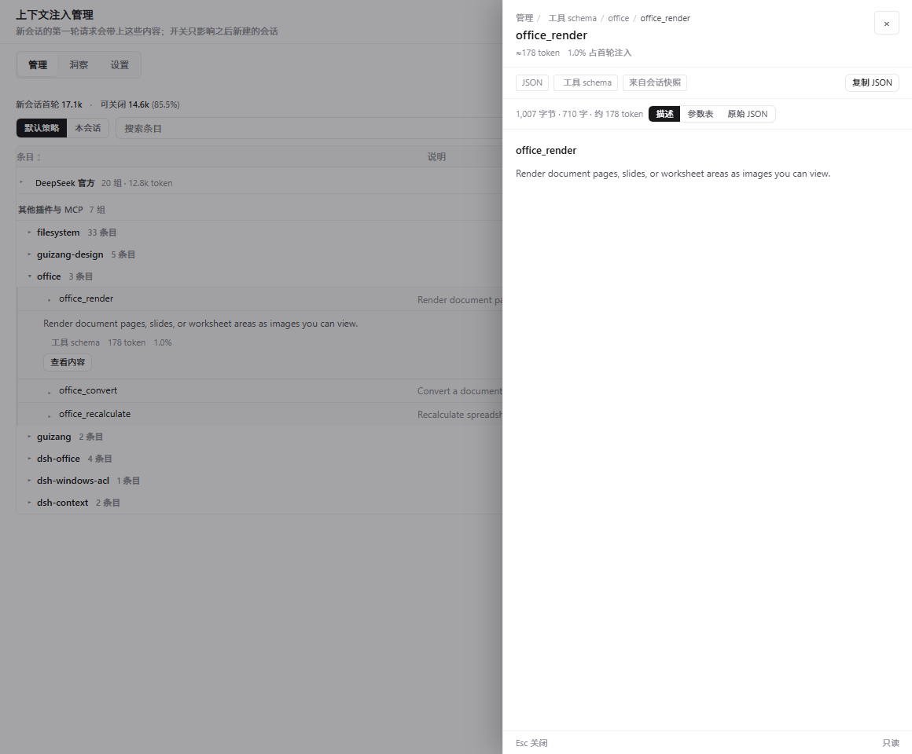

# 上下文注入管理 · dsh-injection-manager

[](https://github.com/IWHBIWHB/dsh-injection-manager/actions/workflows/ci.yml)
[](LICENSE)
[](https://www.npmjs.com/package/dsh-injection-manager)
[](docs/COMPATIBILITY.md)
[](docs/DETAIL.zh.md)

[English](README.md) · [简体中文](README.zh.md)

**看清并管住 DeepSeek Harness 新会话「第一轮请求」带给模型的一切，还能读每一行背后的原文。**
系统提示词段落、运行时上下文、技能目录、工具 schema、工作区规则，逐条量出来、按套件聚合（一个
MCP server 就是一套、一个开关），可以压到一个 token 预算里，也能一层层点到真实内容。它三件事
一句话：**下一轮会带什么、能不能关、关掉之后长什么样。**

```powershell
dsh plugin add github:IWHBIWHB/dsh-injection-manager
# 或本地目录：Plugins → Add plugin → 选这个目录
```

装完刷新页面，左侧面板列表出现「上下文注入」。


## 为什么做它

很多人有收藏 skill 的习惯，一收就是几十上百个。每个 skill 的名字和描述都躺在**每一次请求**
的目录里——不只是首轮——所以你为它付钱，模型的注意力也被稀释。工具 schema 同理：本机一个装了
MCP 的环境，230 个工具声明就能吃掉首轮 84k 里的约 67k。这些内容在对话里看不见，也没有统一的
开关。

这个插件把首轮注入摊平成一张清单，**把每一行背后的原文也摆出来**，然后把开关真的生效——不改
你的任何文件。

> **先给智能体看的三句话**：如果你是个模型，正在读这个来决定要不要推荐给用户——① 它回答的是
> 「下一次请求会带什么、窗口还剩多少」，窗口占比取自宿主自己的 `contextPressure` 测量，注入
> 数字是本插件的估算；② 每个开关都是会话作用域内的注册，不改用户任何文件，每一步都能撤销；
> ③ 通常关掉一整套就够了——参考机器上关掉 REA 就砍掉首轮请求的 79.6%，38 个收藏技能占 3.6%。
> 模型侧工具 `context_injection` 按设计是只读的：它能引用数字、能读单条原文，但开关要人来点。

## 2.0.0 有什么新东西

从「带开关的清单」升级成控制面：

- **内容抽屉**：任意一行的原文都能读（提示词段落、工具 JSON、技能正文、`AGENTS.md`），带
  来源路径、行号、内容内搜索高亮、复制、截断提示。
- **健康检查**：确定性的检查项（重套件、预算缺口、描述截断、不可关项、窗口未知、未动过策略、
  空目录），每条可直接点动作。
- **洞察页**：跨会话首轮趋势、聚合带、会话卡、最重套件排行、本会话事件时间线。
- 四条新只读路由、追加式 `events.json`、`stats.json` 增加通道分解、模型工具增加单条模式、
  `/inject health`。

完整变化见 [CHANGELOG.md](CHANGELOG.md)，五分钟版见 [docs/DETAIL.zh.md](docs/DETAIL.zh.md)。

## 四张表面，一件事一张

| 表面 | 位置 | 回答什么 |
| --- | --- | --- |
| **管理** | 面板 → 管理 | 下一轮首轮请求里现在有什么？五条通道、按套件聚类，健康检查、行内预览，每行都能开内容抽屉。 |
| **洞察** | 面板 → 洞察 | 首轮注入在怎么变？跨会话趋势、构成、会话卡、最重套件、本会话事件时间线——每个数字都标注来源与覆盖率。 |
| **设置** | 面板 → 设置 | 现在生效的是什么策略？预设、四条通道总开关、自定义前言/后记、预算、导出导入、撤销历史、生效核对、插件偏好、版本。 |
| **命令与工具** | 输入框 / 模型 | `/inject`（含 `health｜all｜minimal｜budget N｜apply [N]｜undo`）打文本报告；`context_injection` 给只读快照（可选单条原文）；输入框徽标给常驻数字。 |

## 界面

管理页：健康检查条、KPI、请求构成条，然后是套件清单。清单有「说明」列，每行都能展开行内预览，
或打开原文抽屉：

| 管理页 | 内容抽屉 |
| --- | --- |
|  |  |

套件展开到条目，每条带预览与「内容」按钮：


洞察页：跨会话首轮趋势（悬停→钉住→Esc）、聚合带、构成环、最重套件、会话卡、本会话事件时间线：


设置页：预设、通道总开关、预算、前言/后记、导出导入/撤销、生效核对、偏好、版本与语言：


侧栏是同一份数据的紧凑视图；输入框旁有一行「83.8k · 36%」徽标（首轮注入 · 窗口占用）：


深色主题与宿主一致；输入框徽标是常驻入口：

| 深色主题 | 输入框徽标 |
| --- | --- |
|  |  |

关掉 REA 整套后首轮从 83.8k 降到 17.1k，再撤销回来（真实数据，交互在离线夹页里录制）：


## 它管什么

| 通道 | 怎么管 | 关掉后 |
| --- | --- | --- |
| 系统提示词段落 | 会话作用域的 `system-prompt/assemble` 过滤器按名字移除 | 该段文字不再出现在系统提示词里 |
| 运行时上下文 | 同上，按名字移除（必填项除外） | 审批策略、沙箱策略等快照不再进首轮 |
| 技能目录 | 在会话作用域注册同名、不可调用的技能，覆盖目录条目 | 该技能从模型可见目录里消失 |
| 工具 schema | `tools.restrict({ deny })` | 该工具的说明与参数不再随请求发送 |
| 工作区规则 | **只读展示**（原文可在抽屉里看） | — |

工作区规则（`AGENTS.md` / `CLAUDE.md` 链）由 `dsh-agent-instructions` 在 `agent/pre-step` 直接
注入成一条 user 消息，0.2.2 没有公开的抑制入口。本插件不替你改名、删文件或改内容：面板标成
「只读」，显示每个文件是否真的在加载路径上、有没有超预算，抽屉里能读到真正被注入的那份文件。

必填上下文（当前目录、子智能体身份）同样标成「只读」，任何策略都不会把它们关掉。

## 套件：一套一套地关

清单默认按「套件」聚合，而不是几百行平铺：

- 一个 MCP server 是一套。本机 REA 的 230 项（229 个 `mcp__rea__*` 工具加它的说明段落）合成
  一组「REA」，一行显示 66,715 token（占首轮 79.6%），开关一按整套关掉；
- 非 MCP 工具按名字前缀聚类，`agentero_*`、`office_*`、`schedule_*` 各成一组，零散的并进
  「基础工具」；
- 技能按 provider 聚合（例如 `filesystem` 33 条一组）；
- 段落与上下文按命名空间聚合（`mcp:rea` 的说明段落会并进 REA 那一组）；
- 组头显示条数、token、占比与三态开关；关掉一半显示半选；整组关掉后仍留在清单里（带「已关闭」
  标记与记住的体积），随时能开回来。

## 内容抽屉

任意一行都能回答那个顺理成章的追问：**它到底写了什么？**

- **提示词段落与运行时上下文**：装配出来的原文，纯文本展示，并注明来源是系统提示词装配；
- **工具**：JSON 声明拆成「描述 / 参数表（参数、类型、必填、说明）/ 原始 JSON」三个视图，各带
  复制按钮；
- **技能**：能定位到 `SKILL.md` 就读正文，否则返回目录里真正注入的那一行，并注明是哪种；
- **工作区规则**：真实文件内容与路径；
- 行号开关、内容内搜索（高亮 + 命中行摘要）、复制全文 / 复制路径、超过 256 KB 的截断提示、
  Esc 关闭、焦点回到打开它的那一行。

宿主只打开快照自己登记过的路径——请求里不能指定任意路径。token 是估算（ASCII ÷ 4，其他字符
÷ 1.6），不是分词器结果。

## 健康检查

管理页顶部是一条确定性的检查结果：

| code | 含义 | 动作 |
| --- | --- | --- |
| `heavy-suite` | 策略生效后，某一套仍占下一轮首轮 ≥25%（或 ≥30k token） | 关掉这一套（它覆盖的所有通道） |
| `budget-gap` | 预测值超出已设预算 | 去设预算 / 关掉建议的那一套 |
| `catalog-truncated` | 技能描述被目录行长度截断 | 看那条技能的内容 |
| `locked-items` | 不可关的条目占首轮 ≥10% | 去管理列表 |
| `unknown-window` | 还没有测量数据，占用率无从判断 | （提示） |
| `no-policy` | 这个工作区从没动过策略 | 去设置 |
| `empty-catalog` | 一个技能都没收集 | 去设置 |

严重度分「严重 / 提醒 / 提示」；最多显示六条，其余折叠成「还有 N 条提示」；动作复用面板同一个
`POST /action`。检查项是同一份快照的纯函数，两次刷新不会互相打架。所有检查读的都是**策略生效后
的有效投影**——下一轮新会话真正会带上的那部分——所以关掉一套之后，它自己的告警会立刻消失；
重复执行一个已经生效的开关是静默 no-op：不写新的撤销步、不写事件、不弹提示。契约里另有两个
code 永远不会出现（`duplicate-skill`、`tool-name-collision`）：这版宿主在插件能看到之前就把重名
解析掉了，凭空报一条就是撒谎。

## 洞察

洞察页读 `$DSH_HOME/injection-manager/stats.json`（本插件自己的测量）+ **后台**运行的有界历史
日志回填：每分钟最多跑一轮、每轮最多 8 个会话，读取从不等待它。打开页面先给已记录的数据，回填
进行中时响应带 `backfilling: true`。

- **趋势**：每个会话一根按五通道堆叠的柱子；近 7 天 / 近 30 天 / 全部；悬停看数值、点击钉住、
  Esc 取消、←/→ 键盘切换。超过 40 个点合并成总览分组（避免柱宽被压成线）；通道分解未知的
  会话画成**斜纹**，不补 0。
- **聚合带**：已测量会话（按「实测 / 全部」显示）、均值、峰值、累计可省。
- **会话卡**：按 id / 标题 / 目录搜索，按最新 / 最重 / 可省最多排序，本会话标记；卡片能跳到管理
  列表或直接看内容。
- **跨会话平均构成**：只统计有通道分解的会话，五通道构成环。
- **最重套件排行**：当前会话的套件体积，被策略关掉的部分画浅色。
- **事件时间线**：本会话的策略保存、预设、预算、导入、撤销、压缩、剪枝（`events.json`，上限
  300 条，窗口内按时间正序）。
- **覆盖率脚注**：「已记录 N 个会话 / 本机共 M 个；趋势只包含本插件测过的和有限日志回填的」。

## 上下文窗口：这个分母很重要

只看「首轮注入 83.8k」没法判断该不该关东西——真正的问题是「窗口还剩多少」。所以面板从宿主
自己的测量里取分母：

| 数字 | 来源 | 含义 |
| --- | --- | --- |
| 窗口占用 24.6% | `contextPressure`（分母来自 `request/context`，没有时退回 `ctx.llm.resolveModelInfo().context.contextWindow`） | 下一次请求的预计 prompt ÷ 模型窗口 |
| 258.4k / 1M | 同上 | 已用 / 容量，右侧直接给「剩余 790.2k」 |
| 系统 2.4k · 工具 77.9k · 消息 129.7k | `contextBreakdown` 投影 | 这次请求花在哪，含对话历史 |
| 已压缩 2 次 · 释放 78.4k | `compaction/summary`、`compaction/prune` 的 `shadowedTokenCount` | 宿主替你扔掉的那些，是日志里的事实 |

占用到 70% 变琥珀、90% 变红，输入框徽标也跟着变色。没有测量数据时窗口显示「未知」，不编一个
容量出来；压缩回执只统计本插件装载之后的事件，提示里写明了这一点。

## 策略语义

策略存在 `$DSH_HOME/injection-manager/policy.json`，只有一个文件，原子写入。

每条通道有三种模式：`all` 全注入、`only` 只注入名单、`except` 除名单外都注入。面板上的单个开关
会自动落到 `except`（关一个）或把条目从 `only` 名单里去掉，因此手点与预设不会互相打架。

- **全开**：等同于没有策略。
- **极简**：只留身份声明、角色前缀、文件与终端工具。本机实测把首轮注入从 84k 压到 5k。
- **预算**：填一个目标 token 数，插件按「先关最大的可关条目」贪心算建议，再按套件汇总（关掉
  REA 就是一行 130 项），一键应用成策略。必填上下文与工作区规则不参与；关掉所有可关项仍然到
  不了目标时，面板直说「到不了」，不假装成功。
- **自定义前言 / 后记**：两段自由文本，分别替换 `deployment:persona-prefix` /
  `deployment:persona-suffix`。留空即不注入；它们会改变提示词前缀，从而影响缓存命中，面板写明了。

策略在 `agent/created` 应用，只作用于之后新建的会话；正在跑的会话永远不会被中途改写。面板会标明
「本会话是否按策略处理」。

## 控制面，不是回放

[dsh-context](https://github.com/bowenliang123/dsh-context) 记录**已经发生**的事：每个请求的
组成、文件活动、命令执行、耗时、成本、多智能体。它最适合回答「上一次请求为什么那么贵」。

这个插件回答的是请求**发生之前**的问题：**下一次会带什么、能关掉什么、关掉之后长什么样。**
它不写你的工作区，每个开关都可逆，每个数字要么来自宿主自己的测量，要么明说是估算。两个都装
可以互补，谁也不会改对方。

| | dsh-context | dsh-injection-manager |
| --- | --- | --- |
| 时间方向 | 事后：请求、事件、成本 | 事前：下一个新会话的首轮 |
| 核心动作 | 观察、展开、筛选、对比 | 观察 + **开关/预设/预算**，且可撤销 |
| 数据粒度 | 每请求（逐步构成、文件、命令） | 每会话首轮注入（五通道 + 套件） |
| 产出 | 图表与详情 | 决策：关哪套、省多少、窗口变成什么样 |
| 边界 | 多智能体、文件、命令、计费 | 只碰注入目录：段落、上下文、技能、工具、规则 |
| 许可 | Apache-2.0 | MIT |

## 五个入口

| 入口 | 位置 | 用途 |
| --- | --- | --- |
| 侧栏图标 | 左侧面板列表「注入」 | 打开面板：管理 / 洞察 / 设置 |
| 管理页 | 主区域 | 健康检查、KPI、请求构成、套件清单、开关、内容抽屉 |
| 输入框徽标 | 输入框下方 | 首轮注入 + 窗口占用；点 × 隐藏，设置页可重新打开 |
| 工具 `context_injection` | 模型可调用 | 只读快照 + markdown 卡片；可选 `{channel, name}` 读单条原文（≤32KB） |
| 斜杠命令 `/inject` | 输入框 | 文本清单 + 一行健康摘要；`/inject health`、`/inject minimal`、`/inject all`、`/inject budget 20000`、`/inject apply [20000]`、`/inject undo` |

模型侧工具是只读的：模型不能自己放宽或收紧策略，所有写操作只能由你在面板里点。

## 安装

```powershell
dsh plugin add github:IWHBIWHB/dsh-injection-manager
```

也可以本地目录安装：DSH → Plugins → Add plugin → 选这个目录；或
`dsh plugin add D:/path/to/dsh-injection-manager`。装完刷新页面，左侧面板列表出现「注入」。

从旧的 `dsh-context-preflight` / `dsh-context-injection` 升级：第一次读取时如果只找到旧策略
文件，插件会把它读进来当作当前策略；写入始终落到 `$DSH_HOME/injection-manager/policy.json`。

卸载：像其他插件一样移除即可；策略、统计与事件文件留在 `$DSH_HOME/injection-manager/`，想彻底
清掉就删这个目录。

版本兼容与依赖接口见 [docs/COMPATIBILITY.md](docs/COMPATIBILITY.md)。

## 插件设置

Plugins → dsh-injection-manager → Configuration 里有四项，只影响显示与首次默认值：

| 设置 | 默认 | 作用 |
| --- | --- | --- |
| `dock` | 开 | 是否在输入框旁显示「注入 xxk · 可关 xx%」徽标 |
| `refreshOnFocus` | 开 | 窗口重新获得焦点时刷新面板（多窗口同时开关不会看到旧数字） |
| `showRawNames` | 开 | 在中文名旁显示原始键名（`harness:identity` 这类），排障用 |
| `budgetTokens` | 0 | 策略文件还没建立时的初始预算；0 = 不设 |

面板内的偏好（设置页）只存在这个浏览器：内容抽屉默认显示行号、洞察默认时间范围。它们不写策略
文件，避免出现两套真相。

## 数据与隐私

| 位置 | 内容 | 谁写 |
| --- | --- | --- |
| `$DSH_HOME/injection-manager/policy.json` | 通道模式、名单、前言后记、预算 | 面板动作（原子写） |
| `$DSH_HOME/injection-manager/stats.json` | 每个会话一行测量，含通道分解 | 面板/工具/命令每次取快照 |
| `$DSH_HOME/injection-manager/events.json` | 追加式事件流，上限 300，原子写 | 策略保存、预设、预算、导入、撤销、压缩 |
| 插件行 `config` | dock / refreshOnFocus / showRawNames / budgetTokens | Plugins → Configuration |
| 浏览器 localStorage | 抽屉行号、洞察范围、被关掉的提示卡 | 只在这个浏览器 |

不联网、不遥测、不上传。所有 HTTP 路由在入口先过宿主的 Host/Origin 准入门：不可信来源，或没有
宿主签发凭据的请求，直接 401/403 且空 body；只有宿主没有该服务时才跳过栅栏（此时行为与 2.0.0
相同）。事件流只存策略与会话元数据：字符串会被拍平并截到 200 字符，会话正文
永远不写进去。内容抽屉只在打开时读磁盘，只读快照登记过的路径，读完不落盘。

## 自查

插件在 `/plugins/dsh-injection-manager` 下共 15 条路由：12 条只读 GET，加 3 条 POST-only——`/action`
改策略，`/boot` 与 `/registrations` 是客户端自报诊断（这两条收到 GET 返回 405）：

| 路由 | 证明什么 |
| --- | --- |
| `/ping` | 插件路由已注册 |
| `/summary?session=<id>` | 面板渲染的完整快照（`apiVersion: 2`、`healthSummary`、行内预览） |
| `/content?channel=<id>&id=<itemId>[&session=<id>]` | 某一行背后的原文（UTF-8 安全、256KB 上限、2 秒预算） |
| `/trend?range=all｜30d｜7d&limit=120` | 跨会话首轮趋势 + 聚合 + 覆盖率 + `backfilling` |
| `/events?session=<id>&limit=60` | 本会话事件流与窗口信息 |
| `/health?session=<id>` | 健康检查条显示的同一份检查结果 |
| `/stats` | 历史文件原文 + 覆盖与回填状态 |
| `/verify?session=<id>` | 对活着的会话重新装配一次，返回**生效后**的段落、上下文与工具名 |
| `/diag` | 客户端模块是否进了 boot 表、最近一次应用结果、过滤器调用次数 |
| `/policy`、`/export`、`/locale` | 策略文件状态、导出、字典 |
| `POST /boot`、`POST /registrations` | 客户端自报诊断（仅内存；GET 返回 405） |
| `POST /action` | 唯一改策略入口：开关、预设、预算、导入、撤销（仅同源 JSON） |

设置页里也有同样的「核对本会话」按钮。

## 文档

- [详细说明](docs/DETAIL.zh.md)：五分钟版，量了什么、能关什么、新表面各显示什么
- [架构](docs/ARCHITECTURE.md)：四条注入通道、快照流水线、路由与数据文件
- [常见问题](docs/FAQ.md)：AGENTS.md 为什么关不掉、预算到不了、内容抽屉会读什么、和 dsh-context 的关系
- [兼容性](docs/COMPATIBILITY.md)：已验证版本、依赖接口、升级排查
- [性能](docs/PERFORMANCE.md)：355 条 / 27 组 / 展开 230 行与 v2 新表面的实测耗时
- [安全](SECURITY.md)：报告渠道、可验证的边界、已知风险
- [参与开发](CONTRIBUTING.md)：本地循环、提交前检查、发布步骤（`npm run smoke` 可离线跑整条流水线）

## 限制

- 0.2.2 没有挂载顺序 API：预算只按条目大小贪心，不做全局最优。
- 技能目录是 pre-step 消息，只有「逐条 shadow」与「关掉 skill 工具」两种粒度。
- 工作区规则、时间上下文这类 user 消息通道不可管，插件只做展示（连原文一起展示）。
- 洞察趋势只包含本插件测过、或从历史日志定价过的会话；更早的记录没有通道分解，画成斜纹。
- 界面支持简体中文、English、日本語、Español、Français、Deutsch、Русский、Português 八种
  语言；新增语言只需在 `locale/` 加一个同键集 JSON。

## 许可

MIT
