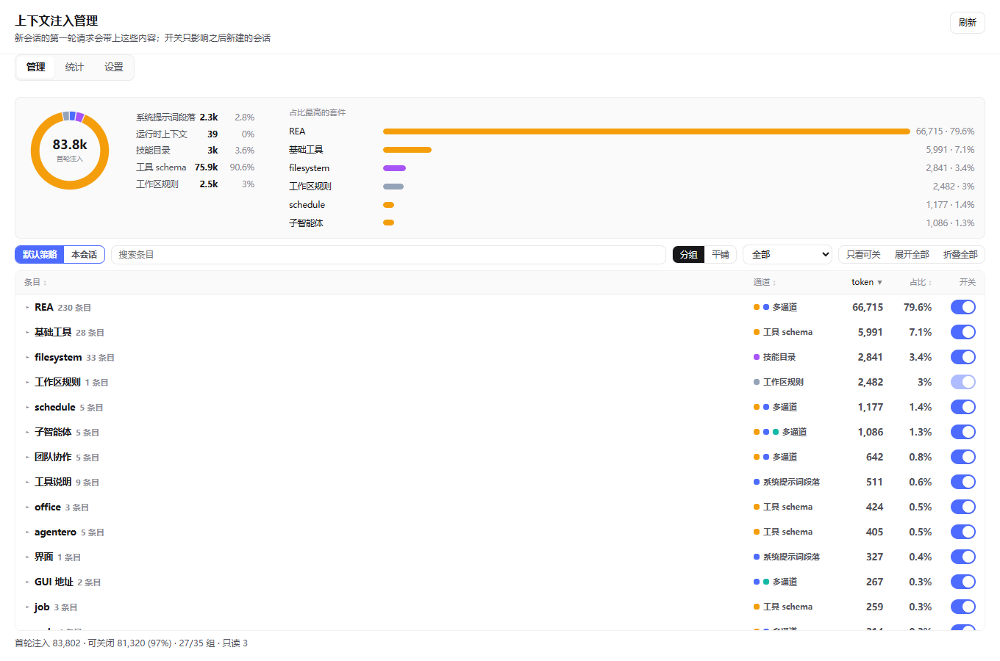
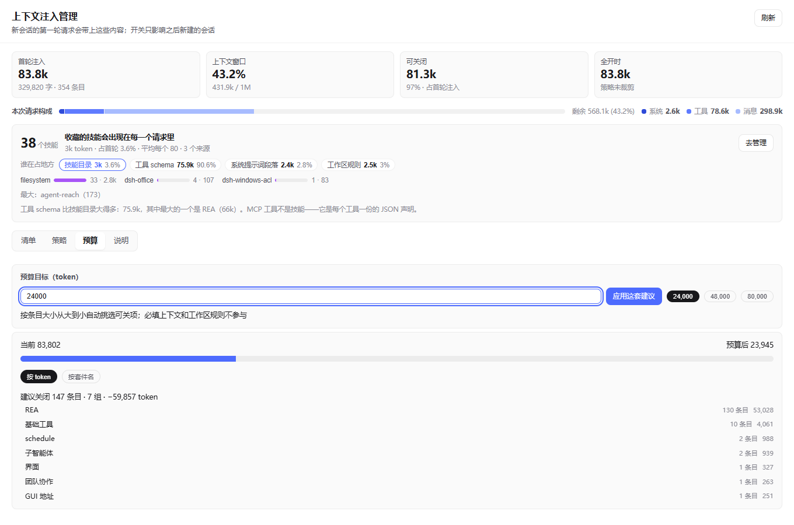
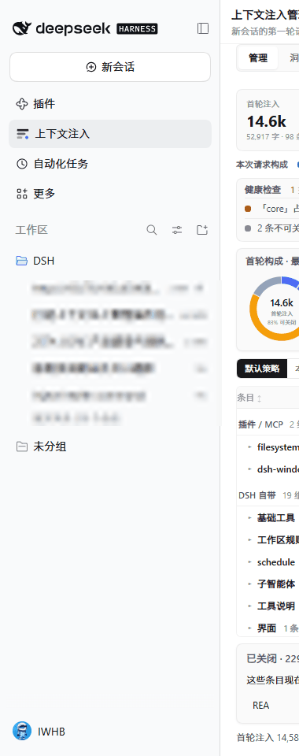
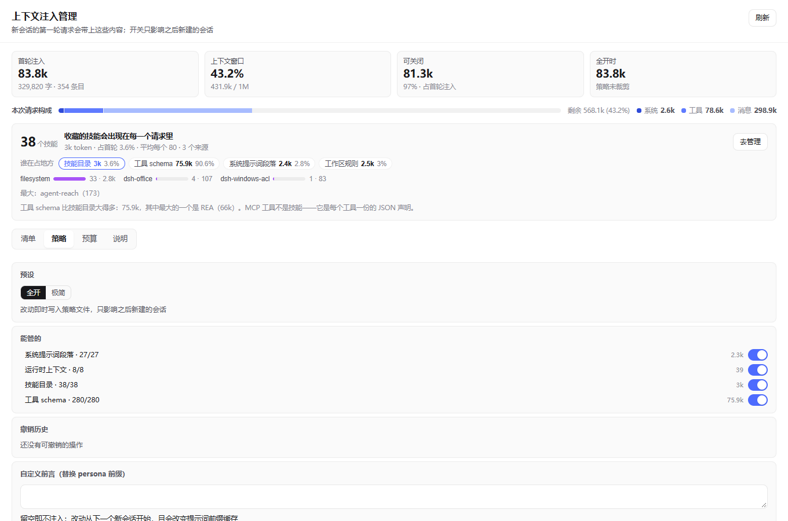
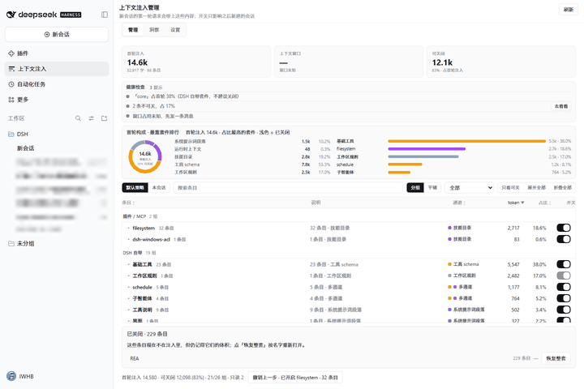

# 上下文注入管理 · dsh-injection-manager

[](https://github.com/IWHBIWHB/dsh-injection-manager/actions/workflows/ci.yml)
[](LICENSE)
[](https://www.npmjs.com/package/dsh-injection-manager)
[](docs/COMPATIBILITY.md)

管住 DeepSeek Harness 新会话「第一轮请求」塞给模型的一切：系统提示词段落、运行时上下文、技能目录、工具 schema、工作区规则。逐条给出字符数与估算 token，按套件聚合，一套一个开关，再给一个 token 预算和两套预设。

> **1.9.9**：八语言、撤销历史（可回退任意一步）、清单导出/导入、按套件聚类、预算外标记、宿主自检、/inject apply｜undo。完整变化见 [CHANGELOG](CHANGELOG.md)。

```powershell
# 装（GitHub 直装）
dsh plugin add github:IWHBIWHB/dsh-injection-manager
# 或本地目录：Plugins → Add plugin → 选这个目录
```

装完刷新页面，左侧面板列表出现「注入」。


## 界面

| 清单 · 按套件 | 预算 · 目标 24k |
| --- | --- |
|  |  |

侧栏同一份数据的紧凑视图，输入框旁还有一行「注入 83.8k · 可关 97%」的徽标：



策略页：预设、四条通道总开关、自定义前言/后记、清单导出与策略导入（可撤销）、最近一次应用记录。深色主题与宿主一致。




关掉 REA 整套后首轮从 83.8k 降到 17.8k，再撤销回来（真实数据，交互在离线夹页里录制）：



## 插件设置

Plugins → dsh-injection-manager → Configuration 里有四项，只影响显示与首次默认值：

| 设置 | 默认 | 作用 |
| --- | --- | --- |
| `dock` | 开 | 是否在输入框旁显示「注入 xxk · 可关 xx%」徽标 |
| `refreshOnFocus` | 开 | 窗口重新获得焦点时刷新面板（多窗口同时开关不会看到旧数字） |
| `showRawNames` | 开 | 在中文名旁显示原始键名（`harness:identity` 这类），排障用 |
| `budgetTokens` | 0 | 策略文件还没建立时的初始预算；0 = 不设 |

真正的开关都在策略文件里，不在这个表单里——避免出现「面板关了但配置还开着」的两套真相。

## 为什么需要它

在一次典型的 DSH 会话里，首轮注入的大头不是你的话，而是工具 schema：本机一个装了 MCP 的环境，280 个工具的描述可以吃掉 75k token，而整个首轮注入是 84k。这些内容你既看不见，也没有统一的开关。

这个插件把首轮注入摊平成一张清单，并把「能关的」真的关掉——不是改你的文件，而是在新会话的作用域里登记一层更近的配置。

## 聚类：一套一套地关

清单默认按「套件」聚合，而不是几百行平铺：

- 一个 MCP server 是一套。本机 `mcp__rea__*` 的 229 个工具合成一组「REA」，一行显示 65,979 token（占首轮 78.7%），开关一按整套关掉；
- 非 MCP 工具按名字前缀聚类，`agentero_*`、`office_*`、`schedule_*` 各成一组，零散的并进「基础工具」；
- 技能按 provider 聚合（例如 `filesystem` 33 条一组）；
- 段落与上下文按命名空间聚合（`mcp:rea` 的说明段落会并进 REA 那一组，而不是单独一条）；
- 组头显示条数、token、占比与三态开关；关掉一半时开关显示半选。

搜索与通道筛选作用在分组视图里，命中的组自动展开；「平铺」视图仍保留，用于逐条微调。

## 它管什么

| 通道 | 怎么管 | 关掉后 |
| --- | --- | --- |
| 系统提示词段落 | 会话作用域的 `system-prompt/assemble` 过滤器按名字移除 | 该段文字不再出现在系统提示词里 |
| 运行时上下文 | 同上，按名字移除（必填项除外） | 审批策略、沙箱策略等快照不再进首轮 |
| 技能目录 | 在会话作用域注册同名、不可调用的技能，覆盖目录条目 | 该技能从模型可见目录里消失 |
| 工具 schema | `tools.restrict({ deny })` | 该工具的说明与参数不再随请求发送 |
| 工作区规则 | **只读展示** | — |

工作区规则（`AGENTS.md` / `CLAUDE.md` 链）由 `dsh-agent-instructions` 在 `agent/pre-step` 直接注入成一条 user 消息，0.2.2 没有公开的抑制入口。本插件不替你改名、删文件或改内容：面板会明确标成「只读」，并显示每个文件是否真的在加载路径上、有没有超预算。

必填上下文（当前目录、子智能体身份）同样标成「只读」，任何策略都不会把它们关掉。

## 五个入口

| 入口 | 位置 | 用途 |
| --- | --- | --- |
| 侧栏图标 | 左侧面板列表「注入」 | 一键打开管理页 |
| 管理页 | 主区域 | 清单 / 策略 / 预算 / 说明 四个标签 |
| 输入框徽标 | 输入框下方 | 首轮注入与可关比例，弱化显示；点 × 隐藏，说明页可重新打开 |
| 工具 `context_injection` | 模型可调用 | 只读快照，含 markdown 卡片 |
| 斜杠命令 `/inject` | 输入框 | 文本清单；`/inject minimal`、`/inject all`、`/inject budget 20000`、`/inject apply [20000]`、`/inject undo` |

模型侧工具是只读的：模型不能自己放宽或收紧策略，所有写操作只能由你在面板里点。

## 能力一览

| 能力 | 在哪用 |
| --- | --- |
| 清单与开关 | 「清单」：四条通道统一列出，按套件聚类，一个 MCP server 一个开关 |
| 预设与预算 | 「策略」「预算」：全开 / 极简 / 自定义；按预算贪心裁剪，结果可撤销 |
| 撤销与历史 | 底栏「撤销上一步」；策略页「撤销历史」可回到任意一步（二次确认） |
| 导出 / 导入 / 复制 | 策略页：Markdown、JSON 导出；导入策略（可撤销）；复制清单 |
| 生效核对 | 说明页「核对本会话」，或 `GET /verify?session=` |
| 命令行 | `/inject all｜minimal｜budget N｜apply [N]｜undo` |
| 模型只读工具 | `context_injection`：与面板同一份快照 |
| 八语言 / 深色 / 键盘 | 跟随宿主语言与主题；按 / 聚焦搜索，Esc 关闭，开关可 Tab 聚焦 |
| 宿主自检 | 版本低于 0.2.2 时顶部提示「部分开关可能不生效」 |

## 60 秒演示

1. 装好重启 DSH，左侧面板列表出现「注入」图标；点开，清单页应看到四条通道和按套件聚类的条目（参考快照：REA 229 项占 78.7%）。
2. 关掉整套 REA：顶部「策略后」从 83.8k 掉到 17.8k，提示写着「已关闭 REA · 229 条目」，右侧带撤销。
3. 切到「说明」页点「核对本会话」：当前会话会显示「未按策略处理（在策略保存前创建）」，这是正常的——策略只作用于之后新建的会话。
4. 新建一个会话（或在任意会话里用 `/inject`），首轮提示词应该只剩预期内容；`/inject` 会打印同一份数字。
5. 想反悔：点提示里的撤销，或底栏「撤销上一步」，或策略页「撤销历史」回到更早的一步。

五步走完，基本能判断它值不值得留在你的配置里。

## 策略语义

策略存在 `$DSH_HOME/injection-manager/policy.json`，只有一个文件，原子写入。

每条通道有三种模式：

- `all`：全注入；
- `only`：只注入名单里的条目；
- `except`：除了名单里的条目都注入。

面板上的单个开关会自动落到 `except`（关一个）或把条目从 `only` 名单里去掉，因此手点与预设不会互相打架。

### 预设

- **全开**：等同于没有策略。
- **极简**：只留身份声明、角色前缀、文件与终端工具（read / write / edit / glob / grep / pwsh / todo_write / ask_user_question / present），其余全关。在本机实测把首轮注入从 84k 压到 5k。

### 预算

填一个目标 token 数，插件按「先关最大的可关条目」贪心算出建议，再按套件汇总（关掉 REA 就是一行 130 项、53k token），一键应用成策略。必填上下文与工作区规则不参与，如果关掉所有可关项仍然到不了目标，面板会直接说「到不了」，而不是假装成功。

### 自定义前言 / 后记

两段自由文本，分别替换 `deployment:persona-prefix` 与 `deployment:persona-suffix`。留空即不注入。它们会改变提示词前缀，从而影响缓存命中，面板里写明了这一点。

## 安装

```powershell
dsh plugin add github:IWHBIWHB/dsh-injection-manager
```

也可以本地目录安装：DSH → Plugins → Add plugin → 选这个目录；或 `dsh plugin add D:/path/to/dsh-injection-manager`。装完刷新页面，左侧面板列表出现「注入」。

从旧的 `dsh-context-preflight` / `dsh-context-injection` 升级：第一次读取时如果只找到旧策略文件，插件会把它读进来当作当前策略，不会丢开关；写入始终落到 `$DSH_HOME/injection-manager/policy.json`。

版本兼容与依赖接口见 [docs/COMPATIBILITY.md](docs/COMPATIBILITY.md)。

## 设计取舍

- **不碰用户文件**。旧版为了「停用某条规则」会重命名 `AGENTS.md`、改 `SKILL.md` 的 frontmatter；新版全部改成会话作用域的注册，随时可逆，也不会因为两个会话工作目录不同而改错项目。
- **只影响新会话**。策略在 `agent/created` 应用，正在跑的会话不会被中途改写；面板会标明「本会话是否按策略处理」。
- **一个快照**。清单、工具卡片、应用策略都从同一份快照算，预览数字就是实际会生效的数字，不做第二份客户端实现。
- **评分口径写清楚**。token 是估算：ASCII ÷ 4、其他字符 ÷ 1.6，不是分词器结果。真实占用以输入框下方统计行为准。

## 自查

- `GET /plugins/dsh-injection-manager/ping`：插件是否注册了路由。
- `GET /plugins/dsh-injection-manager/summary?session=<id>`：面板用的完整快照。
- `GET /plugins/dsh-injection-manager/verify?session=<id>`：对活着的会话重新装配一次，返回**生效后**的段落、上下文与工具名——这是「策略真的落地了」的证据，不是「配置文件改了」。面板「说明」页也有「核对本会话」按钮，结果与这个接口一致。
- `GET /plugins/dsh-injection-manager/diag`：客户端模块是否进了 boot 表、最近一次应用结果、`system-prompt/assemble` 过滤器被调用了几次、前后段落数。

## 文档

- [架构](docs/ARCHITECTURE.md)：四条注入通道、快照流水线、生效时序
- [常见问题](docs/FAQ.md)：关不掉、预算到不了、和 dsh-context 的关系
- [兼容性](docs/COMPATIBILITY.md)：已验证版本、依赖接口、升级排查
- [性能](docs/PERFORMANCE.md)：352 条 / 34 组 / 展开 229 行的实测耗时
- [安全](SECURITY.md)：报告渠道、可验证的边界、已知风险
- [参与开发](CONTRIBUTING.md)：本地循环、提交前检查、发布步骤（`npm run smoke` 可离线跑整条流水线）

## 限制

- 0.2.2 没有挂载顺序 API：预算只按条目大小贪心，不做全局最优。
- 技能目录是 pre-step 消息，只有「逐条 shadow」与「关掉 skill 工具」两种粒度；关掉 `skill` 工具会整段清空目录。
- 工作区规则、时间上下文这类 user 消息通道不可管，插件只做展示。
- 界面支持简体中文、English、日本語、Español、Français、Deutsch、Русский、Português 八种语言；新增语言只需在 `locale/` 加一个同键集的 JSON。

## 许可

MIT
