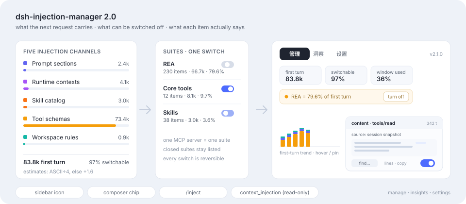

# 这个插件到底改了什么

一个新会话在第一次请求到达模型之前，已经收到了一大堆东西：系统提示词段落、运行时上下文、以文本形式列出的技能目录、每个工具一个 JSON schema，还有 `AGENTS.md` 链。这些内容在对话里完全看不见，也没有一个统一的地方可以关掉。

这页是五分钟版：插件量了什么、能关什么、关不掉什么。总览看 [README](../README.zh.md)，实现细节看 [架构](ARCHITECTURE.md)。

## 1. 两个数字，两个问题

屏幕上的两个数字回答的是不同的问题：

| 数字 | 回答的问题 | 来源 |
| --- | --- | --- |
| 首轮注入（如 83.8k） | **下一个新会话**会被塞进多少东西 | 本插件自己装配：段落与上下文来自 `systemPrompt.assemble()`，技能来自 `skills.snapshot()`，工具 schema 来自 `tools.schemas()`，`AGENTS.md` 按默认链读取 |
| 上下文窗口占用（如 36%） | **当前这段对话**有多满 | 宿主自己的 `contextPressure` 投影 ÷ 模型窗口 |

两者不可比，面板也从不拿一个去减另一个。第一个是插件能控制的部分；第二个决定宿主什么时候压缩。

本插件的 token 是估算（ASCII ÷ 4，其他字符 ÷ 1.6）。占用率不是：`pressureTokens` 是 provider 上报的真实请求大小，窗口来自同一条请求记录。

## 2. 四条通道分别是什么

| 通道 | 注入形态 | 开关方式 |
| --- | --- | --- |
| 系统提示词段落 | `system-prompt/assemble` 装配出的 `system/message` 块 | 在作用域的 `system-prompt/assemble` 瀑布里过滤 |
| 运行时上下文 | 同一次装配的另一半 | 同一条瀑布 |
| 技能目录 | pre-step 的一条 user 消息（名字 + 描述） | 逐条同名 shadow，或直接关掉 `skill` 工具 |
| 工具 schema | 请求里的工具声明 | 会话作用域内的 `tools.restrict({ deny })` |
| 工作区规则 | `AGENTS.md` / `CLAUDE.md` 链 | **关不掉**，只读展示 |

必填上下文（当前目录、子智能体身份）是钉死的：哪怕策略要求，也不会被移除。

## 3. 策略什么时候生效

策略就是一个 JSON：每个通道 `all`、`only [名单]` 或 `except [名单]`，外加可选的人设前言/后记与 token 预算。

它只在 `agent/created` 且 `source` 为 `startup` / `clear` 时应用一次。已经在跑的会话永远不会被中途改写，所以：

- 面板会标明「本会话是否按策略处理」；
- 「策略后」的数字是**下一个新会话**的预估；
- 撤销恢复的是策略文件，同样不会追溯改掉活着的会话。

## 4. 套件

条目按名字聚类：`mcp__<server>__<tool>` 一个 MCP server 一套；非 MCP 工具按共同前缀；技能按 provider；段落与上下文按命名空间——所以某个 MCP server 的说明段落会和它的工具并进同一套。于是一个开关就是「整个 server」，这正是这插件存在的理由。

## 5. 模型看到什么

模型侧工具 `context_injection` 返回和面板完全相同的快照，外加一段「能做什么」：哪一套最划算、本会话是否在策略之前创建、宿主已经压缩掉多少、以及这个工具**不能**自己拨开关。按设计只读，所有写操作都来自人在面板里点。

## 6. 出问题时会怎样

- 宿主低于 0.2.2：顶部提示，开关可能不生效，数字照常显示。
- 本会话还没有测量数据：窗口那一块直接不渲染，不猜一个数。
- 收到本版本还不认识的 `compaction/*` 事件：忽略（回执只是不统计它）。
- 策略文件读不了：面板显示错误，按全开继续跑；`/inject` 仍能打印快照。
